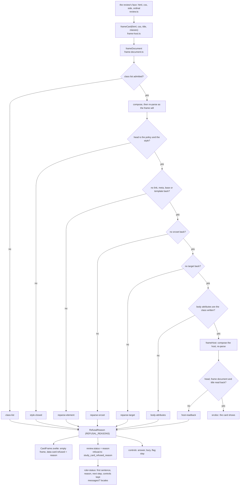
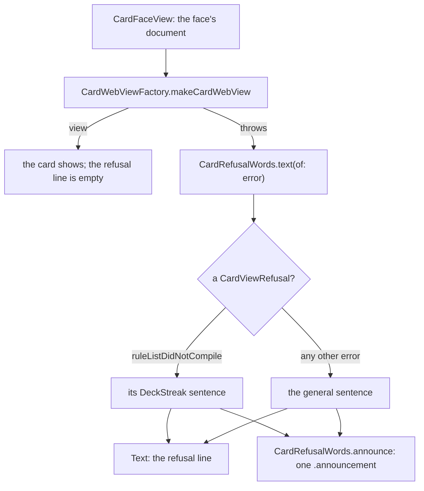

# A frame refusal, from its check to the reason, the status and the controls

SPEC-505, ADR-523. How a card the frame refuses reaches the learner as a reason, on the web and on iOS.

## Web: data flow

The first failing check names the reason; every later check is not read. No branch carries any part of the card past
`frameCard`: the mark, the status and the words are each a fixed value chosen by the reason.

## iOS: data flow

## Components

| component | file | holds |
|---|---|---|
| the checks | `web/app/src/lib/card/frame-document.ts` | `REFUSAL_REASONS`, `RefusalReason`, six checks in order |
| the host | `web/app/src/lib/card/frame-host.ts` | the seventh check, `frameCard` |
| the frame | `web/app/src/lib/card/CardFrame.svelte` | the mark |
| the status | `web/app/src/lib/study/review.ts`, `refusal.ts` | the reason as the status, its key |
| the words | `web/app/messages/*.json` | seven messages per locale |
| iOS words | `ios/App/Sources/CardRefusalWords.swift` | each case's sentence, the announcement |
| iOS face | `ios/App/Sources/CardFaceView.swift` | shows and announces the words |
