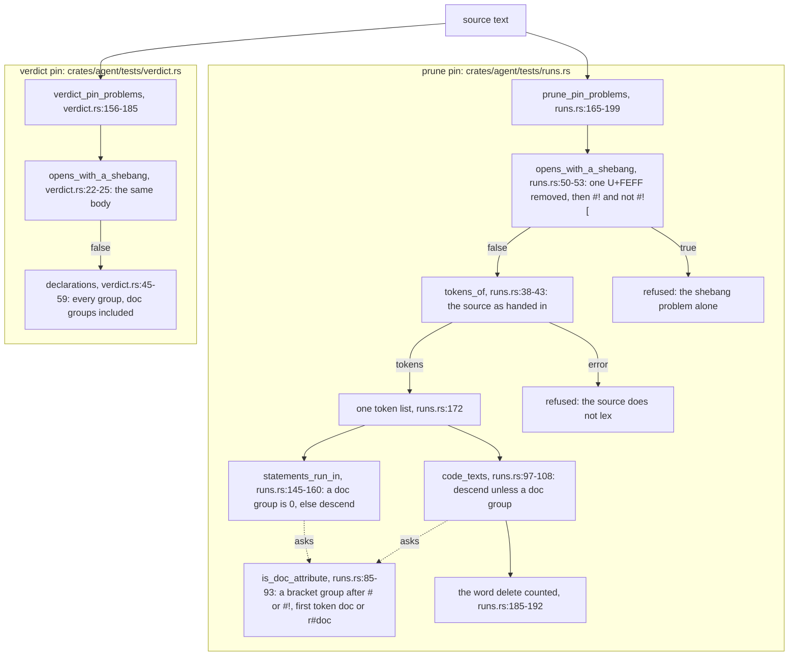
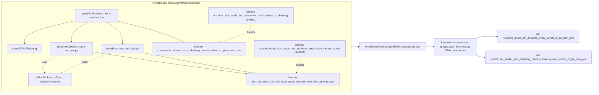

# The prune pin's token groups and their Lean proof

Kind: data flow. SPEC-469, ADR-486, issue #474. Every `path:line` is read at
`36c4783a29c44d2ffafc987803ccb1742a2c2cfc`.

A source text enters a pin, loses one byte order mark for the shebang check only, and is refused or
lexed. The prune pin hands its one token list to two counts, which skip the same doc attribute
groups. The Lean entry `lean/AgentPinGroups` ports each step; its vectors are read back by one test
in each pin's file.

## The Lean port, step by step

| step | code | port | held by |
|---|---|---|---|
| one byte order mark removed, then `#!` and not `#![` refused | `runs.rs:50-53`, `verdict.rs:22-25` | `opensWithAShebang` | theorem 1; witness 1; shebang vectors; A1, A2; rows S46901, S46903 |
| refused before any lex | `runs.rs:166-171` | `prunePinProblems` | theorem 1 |
| one token list to both counts | `runs.rs:172-184` | `prunePinProblems` | the port's shape; A1 |
| a doc attribute group | `runs.rs:85-93`, `runs.rs:61-65`, `runs.rs:79-81` | `isDocAttribute`, `nameOf`, `isPunct` | theorem 2; count vectors |
| the run count's descent | `runs.rs:145-160` | `statementsRunIn` | theorem 2; A1; row S46904 |
| the word count's descent | `runs.rs:97-108` | `codeTexts` | theorem 2; witness 2; A1; row S46902 |
| a call to the query macro | `runs.rs:111-138` | `endsInTheQueryMacro`, `opensWithTheStatement` | count vectors; A1; row S46904 |
| a literal's cooked text | `runs.rs:69-76` | `textOf`, over the token's kind and cooked text | count vectors; A1 |

The lexer is not ported: the pin's port takes any function from text to an optional token list, so
both theorems hold whatever tokens a lexer returns. What rustc does after it lexes is not read
(#444). The verdict pin's `declarations` is not ported (#474 names the prune pin's two counts).
