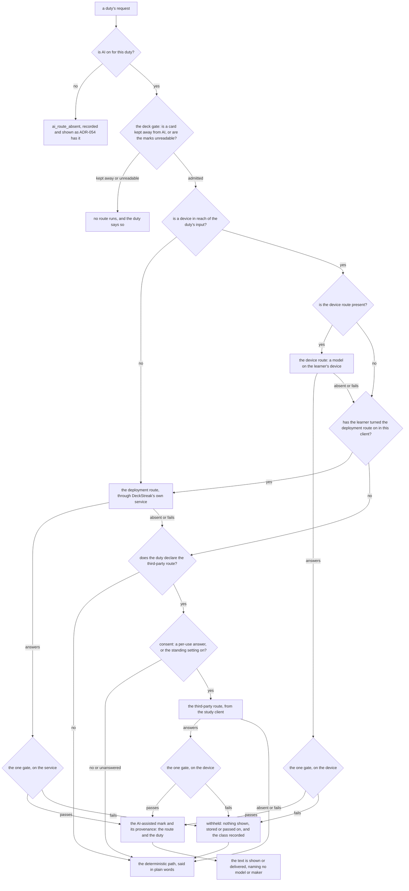
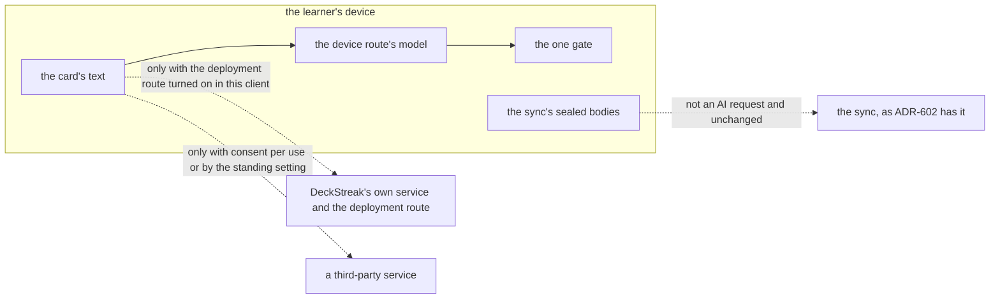

# Schematic: one AI request, its routes, the one gate and the consent checks

Kind: data flow. Read at DeckStreak `dev` from `crates/agent/src/route.rs` (`AiRoute`),
`crates/agent/src/gate.rs` (`OutputGate`), `crates/agent/src/deck_gate.rs` (`DeckGate`),
`crates/agent/src/duty.rs` (`DutyEngine`), `ai-safety.json`, ADR-054, ADR-301 (f), ADR-392, ADR-602
and `docs/schematics/agent-duty-run.md`. Added by SPEC-619 (ADR-641). It draws the planned layout:
nothing in it is built before the owner signs ADR-641.

## One request, from the duty to the shown text

A duty's request meets the AI setting first, then the deck gate, then the routes its declaration
names, in order, each behind its own consent check. Every route's output passes the same gate
before any text is shown or delivered. A refused output is withheld and never moves to a later
route; a route that gives no output is passed over.

| step | what decides it | where it stands |
|---|---|---|
| AI on | a duty the service starts: the deployment's configured route (ADR-054); a duty a study client starts: the learner's AI setting in that client, off by default | SPEC-619 R1 |
| the deck gate | the same marks the service's `DeckGate` reads, through SPEC-381 R7's API routes, for the device route and the third-party route; `DeckGate` itself in front of the deployment route | SPEC-619 R8 |
| a device in reach | the duty's declaration: who starts it and where its input lives | SPEC-619 R3 |
| the deployment route from a client | the learner's setting for that route in that client, off by default | SPEC-619 R9 |
| the third-party route | a per-use answer covering one request, or the standing setting, off by default; never inferred | SPEC-619 R2 |
| the one gate | one definition of CHARTER 17's blocking classes, the same on every route | SPEC-619 R4, R5 |
| the mark | #840's mark, with the route and the duty | SPEC-619 R6 |
| the fallback | the deterministic path each duty declares | SPEC-619 R7 |

A duty with no device in reach, one the service starts on its own or one whose input lives only on
the service, such as the vault, starts at the deployment route and has no third-party route in its
declaration, so its request ends at the fallback when the deployment route gives no output.

## The device boundary: which text may leave the device

| text | may leave the device to | on which consent |
|---|---|---|
| the device route's request | nowhere | none: it never leaves the device |
| a card's text, for an AI request | the deployment route | the learner turned that route on in this client, off by default and withdrawable |
| a card's text, for an AI request | the third-party route | a per-use answer for that request, or the standing setting, off by default and withdrawable |
| a card of a deck kept away from AI | no route | never; and when the marks cannot be read, no route runs |
| the sync's sealed bodies | the sync | not an AI request, and unchanged |

The request that reads the marks carries no card text. A withdrawn consent holds from the next
request; a request already sent is not recalled, and its output still passes the gate.
