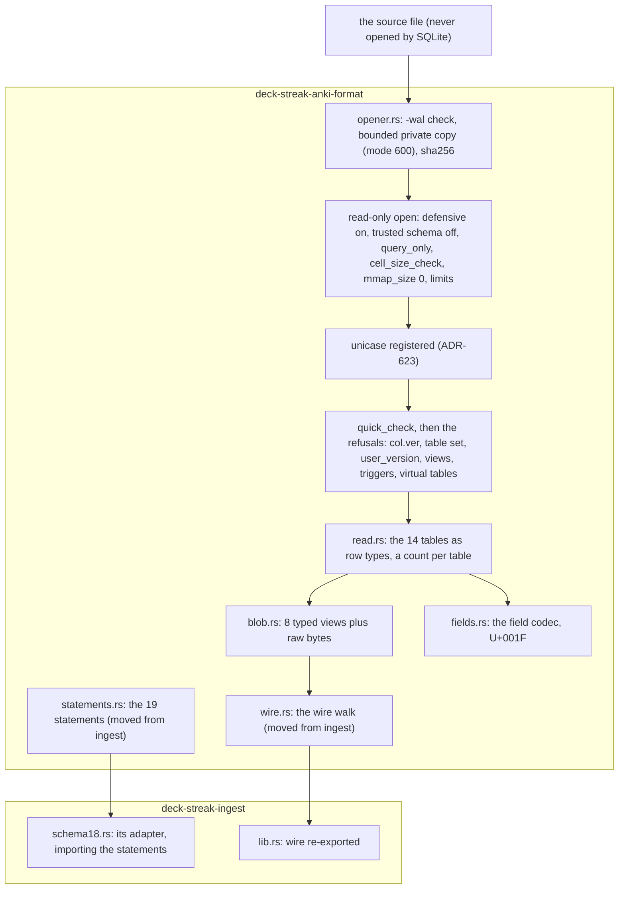

# Schematic: the format crate's components

Kind: component. Read at DeckStreak `dev` at the commit this pull request branches from (SPEC-602, ADR-622,
ADR-623).

A foreign file passes through the defensive opener before any reader sees a row. The opener copies the source's
bytes to a private file under a bound, opens the copy read-only with every defensive setting, registers `unicase`,
checks the copy, and refuses before any row is read. The readers answer DeckStreak's own row types; the blob views
decode through the wire walk and keep their raw bytes. Ingest imports the statements and re-exports the walk.

Every refusal names its check and the object kind or table, never a value. The store's `ForeignFile` in
`deck-streak-collection` is unchanged and is not drawn: it is the opener left to re-point when the read port
switches to this crate.
