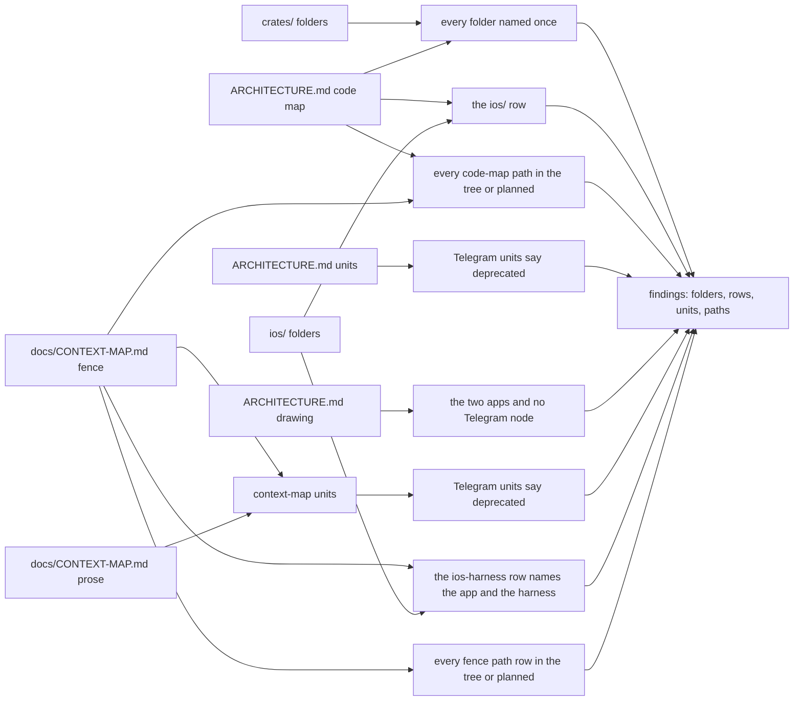

# Schematic: the architecture code map census

Drawn with SPEC-623 and ADR-645, over the two pages as dev held them at the cut.

The census in `scripts/tests/test_architecture_map.py` reads two sources from the tree and two
pages. The crate folders come from the file system under `crates/`, and the `ios/` folders from
`ios/`. ARCHITECTURE.md gives the code map (the table under its `## Code map` heading) and the
drawing (its first mermaid block); docs/CONTEXT-MAP.md gives the fence (each row's name, path,
description and edge list) and its prose. Each page's text is cut into units (a fence row's
description, a table row, a list item, a paragraph), with code spans removed before any match.
Every population passes through `examined` and is refused at zero.

Each of the eight criteria is one node above, left to right in the order SPEC-623 numbers them,
and each red names what it found: a crate folder, a row, a unit's first line or a path. A unit
passes when it names no Telegram surface or holds the stem `deprecat` (ADR-645 D2); a fence row's
name and edge list are set aside, so a kept identifier such as `deck-streak-bot` is never read as
a mention.
