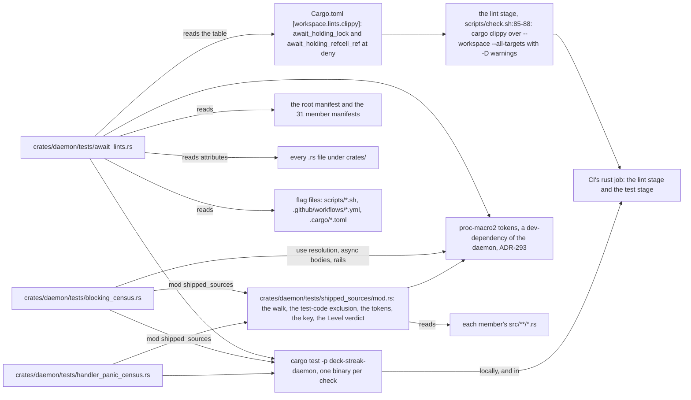
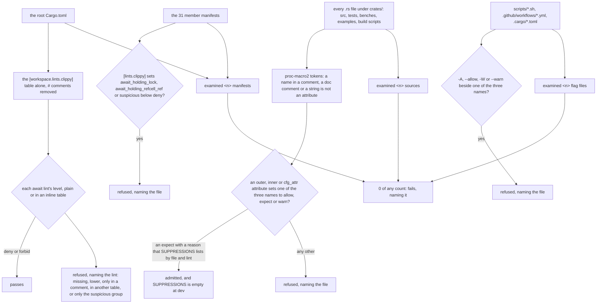
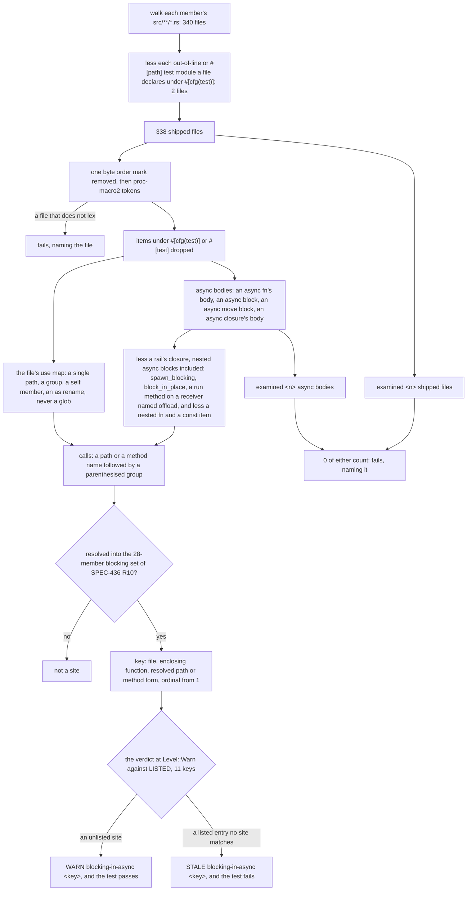
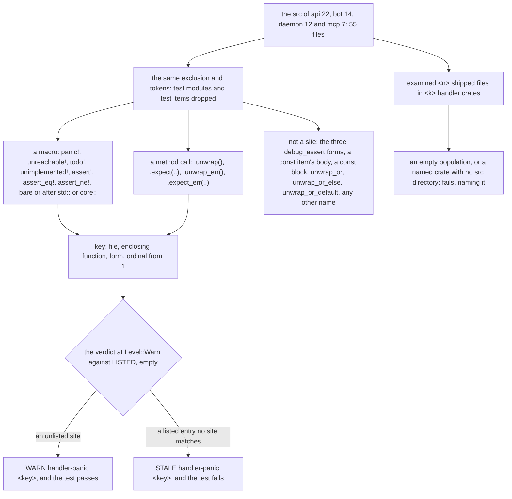

# Schematic: what the await lints' audit, the blocking census and the handler panic census read

Kind: component, and data flow for each check. Read at DeckStreak dev `b25ed04a`. Decided by
ADR-450; built by SPEC-436.

Three checks hold the server's async code: the await lints, named at deny and read by clippy with
an audit that refuses any lowering of them; a census of blocking calls inside async bodies; and a
census of panic forms in the request-handler crates. The two censuses start at warn.

## Where each check lives

Clippy reads the types a coroutine keeps across each suspension point, so the await lints have no
census: their population is every target of every member, tests included, and at dev they report
0 in every crate. The three test binaries are read locally by cargo and in CI's `rust` job; the
lint stage over the whole workspace is read in CI. Each census function takes its sources as data,
a list of (path, text), and only the repository tests read the tree, from `CARGO_MANIFEST_DIR`'s
parent; no test writes a file.

## The await lints' audit

It prints `examined <n> manifests`, `examined <n> sources` and `examined <n> flag files`.

## The blocking census

It prints `examined <n> shipped files` and `examined <n> async bodies`, then
`WARN blocking-in-async <key>` for each unlisted site and `STALE blocking-in-async <key>` for each
listed entry no site matches. A key prints as `<file> <function> <path or form> #<ordinal>`. At
`Level::Fail` an unlisted site fails, naming it. The two test modules left out are
`crates/ingest/src/skip_write/tests.rs` and `crates/vault/src/unicode_other_tests.rs`.

## The handler panic census

It prints `examined <n> shipped files in <k> handler crates`. The four crates are named in the
census, never matched by a pattern.

## Where each runs, and what it examines at dev

| check | runs | examined at dev | sites at dev |
|---|---|---|---|
| the await lints | clippy's lint stage, in CI's `rust` job | every target of every member | 0 |
| the await lints' audit | `cargo test -p deck-streak-daemon --test await_lints`, locally and in CI's `rust` job | the root manifest, the 31 member manifests, every `.rs` file under `crates/` and every flag file | 0 lowerings; `SUPPRESSIONS` empty |
| the blocking census | `cargo test -p deck-streak-daemon --test blocking_census`, locally and in CI's `rust` job | 338 shipped files | 11, listed below |
| the handler panic census | `cargo test -p deck-streak-daemon --test handler_panic_census`, locally and in CI's `rust` job | 55 shipped files in 4 handler crates | 0; `LISTED` empty |

The counts of sources, flag files and async bodies are printed by each run, and each test refuses a
count of 0.

## The blocking sites listed at dev

| file | function | call | ordinal | line at `b25ed04a` |
|---|---|---|---|---|
| `crates/agent/src/gate.rs` | `check` | `std::fs::remove_file` | 1 | 205 |
| `crates/agent/src/gate.rs` | `check` | `std::fs::remove_file` | 2 | 206 |
| `crates/agent/src/gate.rs` | `check_input` | `std::fs::remove_file` | 1 | 220 |
| `crates/agent/src/runner.rs` | `run` | `std::fs::remove_file` | 1 | 91 |
| `crates/ingest/src/skip_write.rs` | `steps` | `std::fs::copy` | 1 | 302 |
| `crates/ingest/src/skip_write.rs` | `backup` | `std::fs::copy` | 1 | 511 |
| `crates/ingest/src/skip_write.rs` | `backup` | `std::fs::set_permissions` | 1 | 512 |
| `crates/ingest/src/skip_write.rs` | `backup` | `std::fs::rename` | 1 | 519 |
| `crates/ingest/src/skip_write.rs` | `restore_check` | `std::fs::read` | 1 | 795 |
| `crates/ingest/src/skip_write.rs` | `restore_check` | `std::fs::read` | 2 | 795 |
| `crates/ingest/src/skip_write.rs` | `restore_check` | `std::fs::write` | 1 | 804 |

A key holds no line number, so an edit above a site keeps its entry; the line column is where each
site was read at `b25ed04a`. A fix removes the site's entry from `LISTED`, which is how a fix is
counted (ADR-450 D5, D6).
