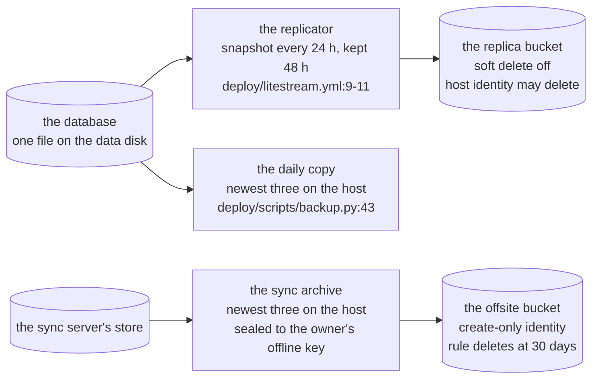
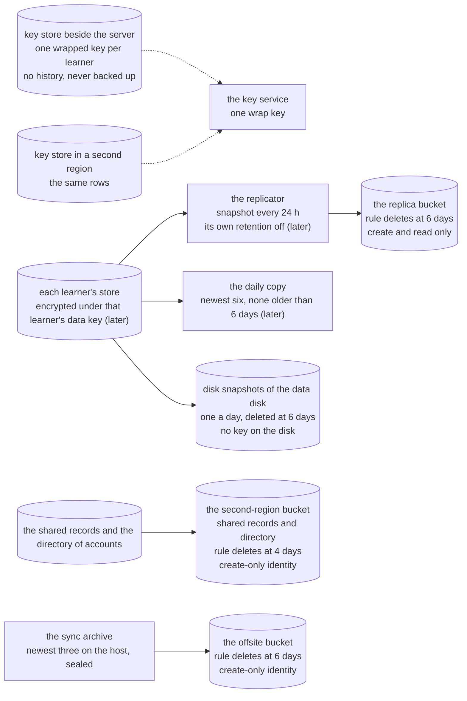
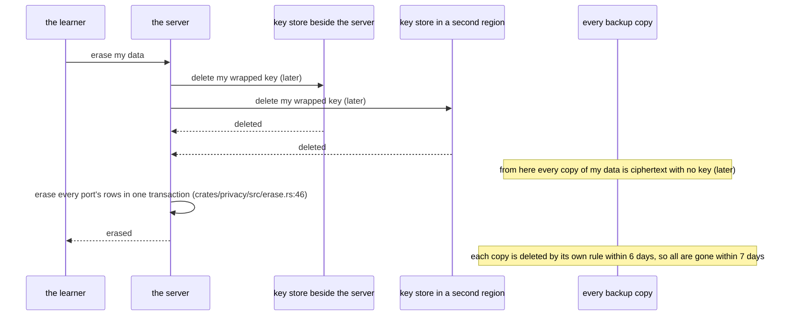
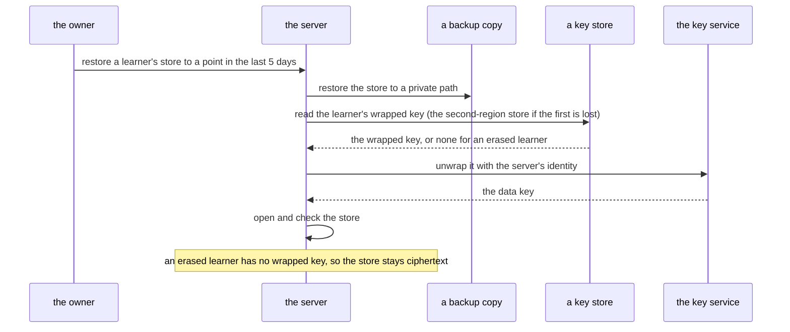

# Backups keep at most seven days, and an erase destroys the learner's key first

Decided by ADR-603 for SPEC-584. Every `path:line` below was read at this delivery's base on `dev`. Kinds:
a component diagram of the backup layers before and after, and two sequences, the erase and the
restore. "Later" marks a step a later delivery builds (SPEC-584 section 9); everything else is
true at `dev` or is the text this delivery changes.

## 1. The backup layers, before

The declared window is `P3D` (`privacy.json:450`); the offsite period is `P30D`
(`ADR-351:125-132`). No copy is encrypted per learner.

## 2. The backup layers, after

The second-region copy is pruned at 4 days old and every other copy at 6, so no copy is older than
7 days (`P7D`). Soft delete is off and no retention lock is set anywhere. The key stores are the only place a wrapped key lives.

## 3. The erase, from the learner's request to the bytes gone

Until the keys exist, the erase is the transaction alone, and an erased row stays readable in a
copy until that copy is gone; the page then claims no crypto-erase (SPEC-584 R7).

## 4. A restore, through the wrap key

The weekly restore rehearsal runs this with a synthetic rehearsal learner and a synthetic erased
learner (SPEC-584 R8, later, after the park lifts).

## 5. Each step, its test and its row

| step | held by | red at the base | row |
|---|---|---|---|
| the declared window is `P7D` | A1 (`test_backup_window`) | the inventory reads `P3D` | `S58401` |
| the replica and daily-copies bullets state `P7D` and today's ages | A1; CI's `test_backup_units` window test | the bullets state `P3D` | `S58401` |
| the disk snapshots and the second-region copy are disclosed with `P7D` | A4 | neither bullet exists | `S58404` |
| the offsite archives' period is `P7D` | A2 (`test_privacy_policy`) | the bullet states `P30D` | `S58402` |
| the runbook checks the bucket rule with `P7D` | A3 (`test_sync_server_runbook`) | the runbook states `P30D` | `S58403` |
| every record that stated an older period carries its amendment | A5 | no amendment exists | `S58405` |
| the page claims crypto-erase exactly when the key table exists | A6 | not red: a guard with two plants | `S58406` |
| the key-first erase, the key stores, the restore through the wrap key | the key-layer delivery (later) | its own reds | its own band |
| the prune of each layer at its age (6 days, the second-region copy 4), the disk snapshots, the second-region copy | the deploy delivery (later) | its own reds | its own band |
