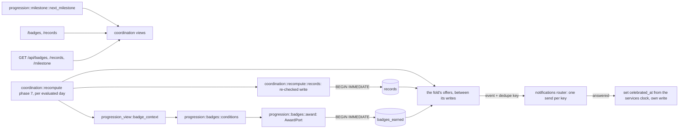
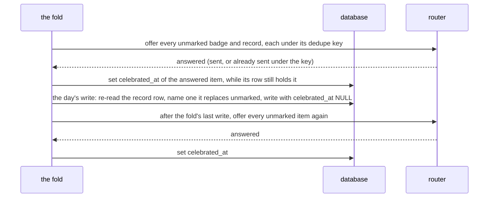
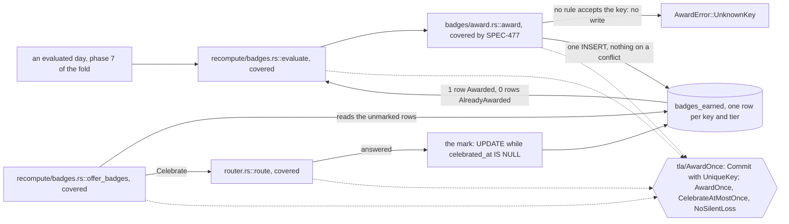
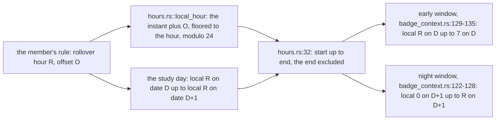
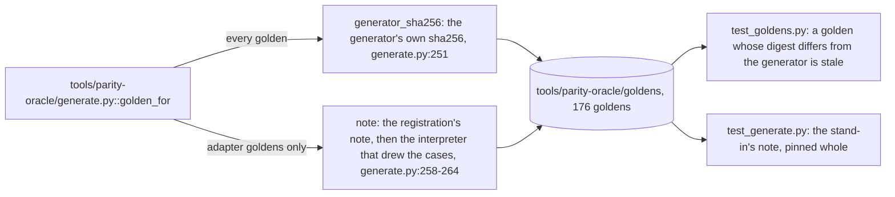

# Schematic: badges, records and the next milestone, awarded once and celebrated at most once

Kind: component, data flow and sequence. Built by SPEC-073, decided by ADR-303 (the design the
model `formal/tla/AwardOnce/` chose) and by ADR-041 (the router's once-ever dedupe key). It ports
the predecessor's badge conditions, record detection and next-milestone selection, which the
parity goldens under `tools/parity-oracle/` hold.

## 1. The components

Each row is progression's. `badges_earned` has one row per (key, tier); `records` has one row per
kind, and its `study_day` names the day that set it. `celebrated_at` is the one column a later write
sets, after the router answers; a band badge is written already marked.

## 2. The sequence of one evaluated day

Each arrow into the database is its own `BEGIN IMMEDIATE` write, and the router writes through its
own connection (`router.rs::route` opens `self.db.write()`), so no offer runs inside a write. A crash
between any two steps leaves the row unmarked: the next offers, of this evaluation or of any later
one, offer it again, and the router's unique dedupe key keeps each to one send. A router call that
does not answer marks nothing.

## 3. The re-check on the records write

A record row holds one kind. The offers before a day's write give an earlier day's unmarked record
its send. The write itself re-reads the row inside its own `BEGIN IMMEDIATE`: when it is about to
replace an earlier day's row whose mark is still unset (the router did not answer, or a crash fell
between), it names that record in a log line with its kind, its day and "celebration not sent", and
then writes. The write never waits for the router: deferring it until the mark is set would stall
every later record while the router does not answer (ADR-303).

This section corrects the earlier text, which had the offer run inside the write's own read: the
router opens a write of its own, so the code cannot do that.

## 4. The milestone

`next_milestone` is a pure function of three numbers over three ladders. The winner has the smallest
`remaining / rung`; a tie keeps the earlier ladder (reviews, streak, mature). The mature input is
Road to C2's, so until it supplies one the view answers `pending` and computes nothing from a stand-in.

The ports are `Offers` and `Celebrate`, not `AwardPort`: the fold calls `Offers` between its writes, and `Offers` hands each owed award to `Celebrate`, the router's send, whose answer comes before the mark is set.

## 5. The award path's cover, the hour windows' edges and the goldens' note (SPEC-477)

Kind: data flow. Added by SPEC-477, decided by ADR-494. Every `path:line` below was read at commit
`36c4783a29c44d2ffafc987803ccb1742a2c2cfc`.

### 5.1 The award path and the award-once model

| step | code | what the model reads it as | covered |
|---|---|---|---|
| the key's rule | `award.rs:86-97`, refusal at `award.rs:110` | a refused key writes nothing: a stutter | by the cover on `award` |
| the write | `award.rs:121-136` | `Commit`: one award per key and tier when `UniqueKey` holds | by the cover on `award` (SPEC-477 R1) |
| the answer | `award.rs:137-141` | `AlreadyAwarded` raises nothing in the write; the offers raise it | by the cover on `award` |
| the mark's value | `award.rs:113-116` | a catalog badge written unmarked (design "mark"); a band badge written marked by a caller no cover names | by the cover on `award` |
| the step's award | `recompute/badges.rs:98-104` | `Commit` in the fold's write | `badges.rs::evaluate`, already |
| the offers and the mark | `recompute/badges.rs:178-206` | `DrainOffer`, `Offer`, `DrainMark` | `badges.rs::offer_badges`, already |
| the router | `router.rs::route` | `Router(d)` | already |

A change to `award` now reads `STALE` on the model's three properties (SPEC-477 F1, F2).

### 5.2 The hour windows the class rule's edge members vary

The rules are the default (rollover 4 at offset 0), rollover 4 at UTC+1, and rollover 5 at
UTC-5:30. Each member places 50 answers one second apart on one side of one edge.

| edge | side | window | planted copy it reads red | row |
|---|---|---|---|---|
| midnight, between D and D+1 | before | none | the hour rounded to the nearest (`hours.rs:19`) | none: `hours.rs` |
| midnight, between D and D+1 | after | night | the night window from hour 1 (`badge_context.rs:126`); `start + 1` (`hours.rs:32`) | S47700 |
| R on D+1 | before | night | the offset added twice under UTC+1 (`hours.rs:17`) | none: `hours.rs` |
| R on D | after | early | the night window's end included (`badge_context.rs:127`); the early window from R + 1 (`badge_context.rs:133`); `start..=end` and `start + 1` (`hours.rs:32`); the offset not applied under UTC+1 (`hours.rs:17`) | S47701, S47702 |
| 7 on D | before | early | the hour rounded to the nearest; the offset added twice under UTC+1 | none: `hours.rs` |
| 7 on D | after | none | the early window's end included (`badge_context.rs:134`); `start..=end` (`hours.rs:32`) | S47703 |
| every edge, under the two other rules | both | as above | a window that reads the default rule (`badge_context.rs:124`, `:131`) | S47704, S47705 |

The code admits no window whose start is above its end, so no member configures one that crosses
midnight: the night window begins at it, and the two midnight members hold both sides.

### 5.3 The goldens' note

| step | today | after part B | test or row |
|---|---|---|---|
| the interpreter in the note | implementation and full version | implementation and minor version | A2, A3; rows S47710, S47711 |
| each golden's digest | the generator's digest | the new generator's digest, every golden | A4 |
| each golden's note | a patch release | the minor version, once | the regeneration's diff, one line per adapter golden |
| each golden's cases | drawn from the predecessor's recorded commit | byte-equal | the regeneration's diff, no other line |
