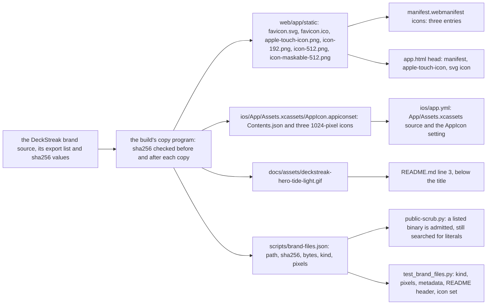
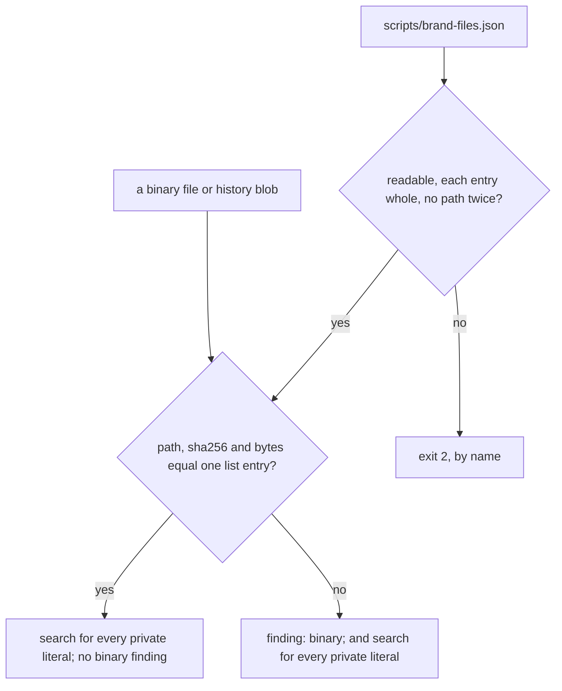

# Brand files: copied once, listed once, admitted and checked from the list

A data-flow schematic of SPEC-579 (ADR-598). Every `path:line` citation was read at dev `57cbb5e1`;
the new paths are SPEC-579's.

## 1. Where each brand file goes

## 2. The scrub's decision for one binary

## 3. Each step, its proof, its red and its row

| step | what holds it | red planted | row |
|---|---|---|---|
| each file is the brand's, byte for byte, kind and pixels | A1, `test_brand_files.py` | at the base no list and no file exist | none |
| a missing file, a changed byte, other pixels, a text or time chunk | A2 to A5, over fixtures | each planted in a copy of the complete set | none |
| the complete set | A6, the control | none | none |
| the README's title, hero and paragraph in order | A7 to A9 | at the base line 3 is the paragraph; planted: the image above the title, an image that is not listed | S57904 (the hero's path) |
| the app target names the catalog and its icon set | A10 to A12 | at the base no catalog line and no setting; planted: an icon removed, the setting removed | S57905 (the icon setting) |
| the manifest, the static icons and the head links | A13, A14, `manifest.test.ts` | at the base the icons are endpoints and two entries; planted: a manifest without the maskable entry | none (web data: no rows table) |
| a listed binary passes both scans | A15, `test_public_scrub.py` | at the base every binary is refused | none |
| other bytes at a listed path, listed bytes at another path | A16, A17 | not red: kept refusals, pinned | S57901 (admission by path alone), S57902 (admission by content alone) |
| a literal inside a listed binary | A18 | not red: the kept literal search, pinned | S57903 (the admitted branch skips the search) |
| a list that cannot be read | A19 | at the base the scrub ignores the list | none |

## 4. What stays as it is

Every screen, the harness's catalog and its project spec (`ios/project.yml:34`, `:48`), the bot and
the Mini App, `csp.test.ts`'s page policy, and the scrub's handling of every unlisted binary.
