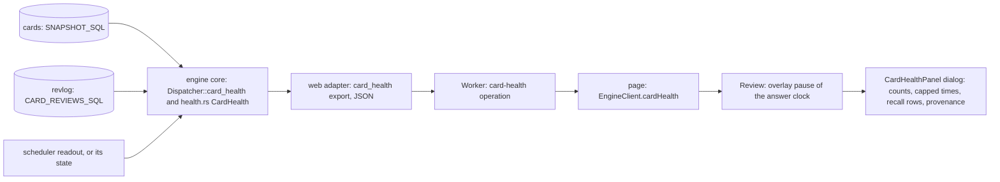

# The card health panel: data flow (SPEC-507, ADR-525)

The panel's figures come from two fixed reads the engine core holds and from the scheduler's readout. The core
builds one record of integers and closed enums; the web adapter answers it as JSON over the Worker's one
`card-health` operation; the review opens it in a dialog and stops its answer clock while it is open.

- Nothing is written: both reads are selects, and the Worker serves the operation over the collection already open.
- The recall rows show a number only for a Ready readout; every other state reads its line.
- The answer clock: opening the dialog starts an overlay pause; closing it ends the pause; a grade sends the time
  shown minus every pause.
