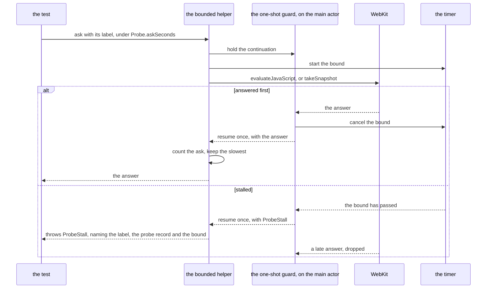

# Schematic: one card probe ask under its bound, answered and stalled

Kind: sequence.
Decided by ADR-631, built by SPEC-609. Read at the dev commit `b065fce` (`ios/CardProbeTests/PlantedCardTests.swift`).

## One bounded ask

The test, through `Probe.evaluate`, the load wait's ready ask or `Probe.snapshot`, asks a page through the one
bounded helper. The one-shot guard holds the ask's continuation; WebKit's answer and the bound's timer race to it,
and it resumes the continuation with whichever comes first, once.

A stall ends the test: every helper between the ask and the test rethrows it, and XCTest names the test with the
stall's description. Each test's `tearDown` prints its `card probe asks:` line, the asks answered and the slowest,
against the bound.

## Where each step lives

| step | at `b065fce` | with the bound |
|---|---|---|
| a page's script answer | `ios/CardProbeTests/PlantedCardTests.swift:280` (`Probe.evaluate`, one unbounded continuation) | through the bounded helper, its label from the script |
| the load wait's ready ask | `ios/CardProbeTests/PlantedCardTests.swift:401` (`Probe.reply`, one unbounded continuation, asked from line 382) | through `Probe.ask(asking:_:label:seconds:)`, label `ready` |
| a view's snapshot | `ios/CardProbeTests/PlantedCardTests.swift:471` (`Probe.snapshot`, one unbounded continuation) | through the bounded helper, label `snapshot` |
| the poll between checks | `ios/CardProbeTests/PlantedCardTests.swift:315` (`Probe.poll`, bounding only between checks) | takes a throwing check and rethrows its stall |
| the answer phase | `ios/CardProbeTests/PlantedCardTests.swift:387` (`askOnce`, which awaits no ask) | unchanged |
