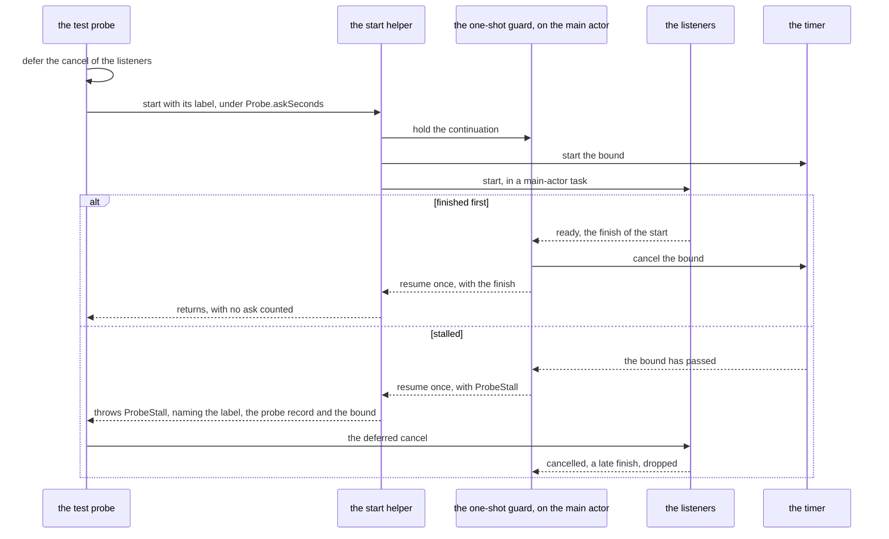

# Schematic: one card probe start wait under the ask bound, finished and stalled

Kind: sequence.
Decided by ADR-646, built by SPEC-624. Read at the dev commit `7bd6923` (`ios/CardProbeTests/PlantedCardTests.swift`).

## One start wait

The test's probe, in `show`, registers the listeners' cancel and then starts them through the one start helper. The
helper hands its continuation to SPEC-609's one-shot guard and runs the start in an unstructured main-actor task;
the start's finish and the bound's timer race to the guard, and it resumes the continuation with whichever comes
first, once. The witness, the two rule list compiles and the planted cookie take the same path, each under its own
label.

A stall ends the test: XCTest names the test with the stall's description. A start wait is no page ask, so the
`card probe asks:` line of each test's `tearDown` counts none.

## Where each step lives

| step | at `7bd6923` | with the bound |
|---|---|---|
| the listeners each probe starts | `ios/CardProbeTests/PlantedCardTests.swift:664` (`show`, `listeners.start()`, its `defer` after the start at line 665) | through the start helper, label `listeners`, its `defer` above the start |
| the lookup witness | `ios/CardProbeTests/PlantedCardTests.swift:1336` (`witness.start()`, its `defer` after the start at line 1337) | through the start helper, label `witness`, its `defer` above the start |
| the probe's rule list compile | `ios/CardProbeTests/PlantedCardTests.swift:300` (`Probe.make`, `compileContentRuleList`) | through the start helper, label `rule list`, its `try?` inside |
| the warm-up's rule list compile | `ios/CardProbeTests/PlantedCardTests.swift:563` (`Probe.warmUp`, `RuleList.compile()`) | through the start helper, label `warm-up rule list` |
| the planted cookie | `ios/CardProbeTests/PlantedCardTests.swift:1239` (the cookie store's `setCookie`) | through the start helper, label `cookie` |
| the listeners' ready wait | `ios/CardProbeTests/Listeners.swift:132` (resumed on ready, failed or cancelled only) | unchanged; the deferred cancel ends it |
| the factory's own build | `ios/CardIsolation/Sources/CardIsolation/CardWebViewFactory.swift:26` (`RuleList.compile()` in `makeCardWebView`, awaited at `ios/CardProbeTests/FactoryTests.swift:127`, `:267`, `:300` and `:318`, and at `ios/CardProbeTests/PlantedCardTests.swift:1040`) | kept: its own wait |
