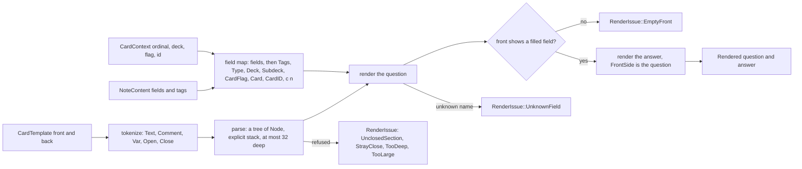
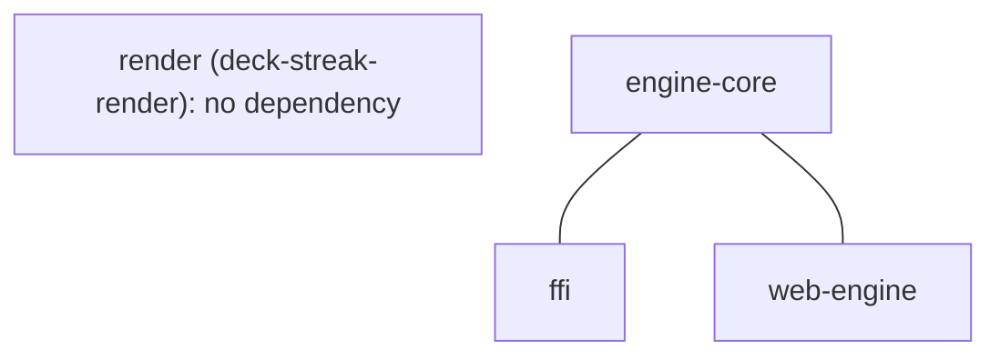

# Card renderer

Kind: data flow and component. Read at the `dev` commit this delivery is cut from; it cites no line.

The render crate (SPEC-603, ADR-624) turns a note type, a note's content and a card's context into the card's two
faces, or into one `RenderIssue` class with DeckStreak's own text.

## Data flow

Filters run right to left over a field's text: `text`, `hint` (a `details` element), the `type` marker,
`furigana`, `kana`, `kanji` and `tts`; an unknown filter passes the text through.

## Types

| type | holds |
|---|---|
| `NoteType` | `name`, `kind` (`Standard` or `Cloze`), `fields` (names in order), `templates` |
| `CardTemplate` | `name`, `front`, `back`, as written |
| `NoteContent` | the note's field values and tags |
| `CardContext` | the card's ordinal, deck path, flag and id |
| `Rendered` | `question` and `answer` HTML |
| `RenderIssue` | a class; `message` and `face` give DeckStreak's text |

## Component view

`render` stands beside `engine-core`, `ffi` and `web-engine` with no edge yet (ADR-624 D2): the first delivery
that calls it draws its edge.
