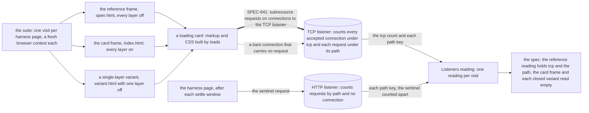

# The card suite's loading cards and the connection counter (SPEC-641)

A data-flow schematic of the web card suite's planted cards that load with no click: where each
card's arrivals go, which listener counts them, and how one reading per visit is built. Every
`path:line` citation was read at `36efa139`. SPEC-641 and ADR-664 decide it; it builds on
`docs/schematics/card-frame-channels.md`, whose section 13 places the counter on a followed link's
path, and leaves that file unchanged.

## 1. A loading card's arrivals

The suite opens a loading card in three harness pages. Its markup and CSS request subresources
under the card's own path; at the head each such request rides a connection to the TCP listener,
which counts the connection under `tcp` and the request under its path. The thick edge is
SPEC-641's aim; the dotted edge is the bare connection the card frame and each closed variant must
not open. The sentinel is the harness page's own request, and only the HTTP listener sees it.

## 2. The planted cards that load

Every planted card with no click, 21 of them: the sixteen `loads()` builds
(`web/app/tests-card/planted.ts:75-78`), then the three connection-only cards (`:154-177`),
`webrtc` (`:220-227`) and `bridge` (`:228-235`). "Layer alone" is the one layer whose removal
alone opens the card, or none when two or more hold it.

| card | layer alone | listener named at `36efa139` | listener named at the head | declared arrivals at the head |
|---|---|---|---|---|
| `img` | W2 | HTTP | TCP | `tcp`, `/img/` |
| `srcset` | none | HTTP | TCP | `tcp`, `/srcset/1`, `/srcset/2` |
| `css-url` | W2 | HTTP | TCP | `tcp`, `/css-url/` |
| `css-import` | W2 | HTTP | TCP | `tcp`, `/css-import/` |
| `font` | W2 | HTTP | TCP | `tcp`, `/font/` |
| `media` | W2 | HTTP | TCP | `tcp`, `/media/` |
| `stylesheet` | none | HTTP | TCP | `tcp`, `/stylesheet/` |
| `preload` | none | HTTP | TCP | `tcp`, `/preload/` |
| `prefetch` | none | HTTP | TCP | `tcp`, `/prefetch/` |
| `meta-refresh` | none | HTTP | TCP | `tcp`, `/meta-refresh/` |
| `base` | none | HTTP | TCP | `tcp`, `/base/` |
| `nested-frame` | W2 | HTTP | TCP | `tcp`, `/nested-frame/` |
| `object` | none | HTTP | TCP | `tcp`, `/object/` |
| `script-inline` | none | HTTP | TCP | `tcp`, `/script-inline/` |
| `script-src` | none | HTTP | TCP | `tcp`, `/script-src/` |
| `event-handler` | none | HTTP | TCP | `tcp`, `/event-handler/` |
| `preconnect` | W3 | TCP | TCP | `tcp` |
| `dns-prefetch` | W3 | TCP | TCP | `tcp` |
| `shadow-link` | W3 | TCP | TCP | `tcp` |
| `webrtc` | none | the loopback host name only, with the UDP port | the same | `udp` |
| `bridge` | none | none | none | the five `bridge:*` counters |

## 3. The reading at each visit

Each visit resets the listeners, opens one harness page in a fresh browser context, and reads every
arrival from the listeners and the page's bridge counters (`web/app/tests-card/listeners.ts:106-115`),
never from the browser's own events.

- **The reference frame, every layer off.** The pair test waits until the reading holds every
  declared arrival (`web/app/tests-card/card.spec.ts:77-89`): `tcp` and the card's own path. The
  `tcp` key is the one that proves the counter can read above zero, in the same test as the card
  frame's zero; the path key shows the connection carried the card's own request. A card
  UNOBSERVABLE in an engine (WebKit's `prefetch`) instead reads `{}` there, after its settle window
  and the sentinel.
- **The card frame, every layer on.** After the settle window and the sentinel, the reading must
  be `{}` (`card.spec.ts:124-125`). At the head that zero refuses a `tcp` key as well as a path:
  a bare connection out of the card frame reads red.
- **The single-layer variants.** With a card's own layer removed alone, the variant must reach the
  declared arrivals, `tcp` and the path, as the reference does (`card.spec.ts:144`): for the six
  W2-alone loading cards this is the `W2 off` control, in the same run as the closed variants. Each
  other layer removed alone must read `{}` (`card.spec.ts:145`), which at the head refuses a bare
  connection too.
- **The sentinel.** After each settle window the harness page requests a sentinel path from the
  HTTP listener and the reading waits for it (`listeners.ts:132-142`), proving that listener still
  counts. It never reaches the TCP listener, so the `tcp` count is the card's alone.
