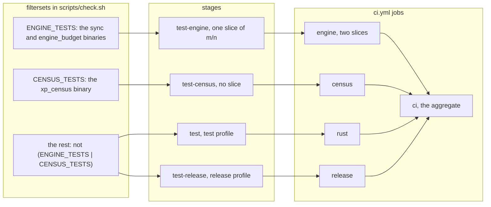

# The census set, the engine set and the rest: filtersets, stages and jobs (SPEC-632)

Drawn from this change's `scripts/check.sh` and `.github/workflows/ci.yml`. Three nextest
filtersets split the workspace's tests;
four stages of `scripts/check.sh` read them; four `ci.yml` jobs run those stages, each a need of
the aggregate `ci`.

Each test of the workspace runs in exactly one stage of a profile: the rest in `test` and again in
`test-release`, the engine set in `test-engine`, and the census set once, in `test-census`, in the
test profile. `test-engine` and `test-census` derive their `--test` targets from their own set's
`binary_id(=<package>::<target>)` terms, so cargo builds only those targets.

The `census` job restores the Rust cache keyed on the toolchain pin and `Cargo.lock` and saves
none, as the engine and release jobs do, and uploads its stage logs as `check-stage-logs-census`.
