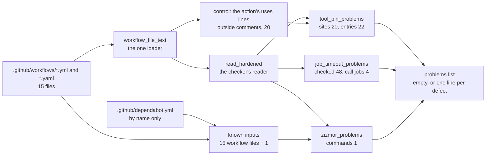
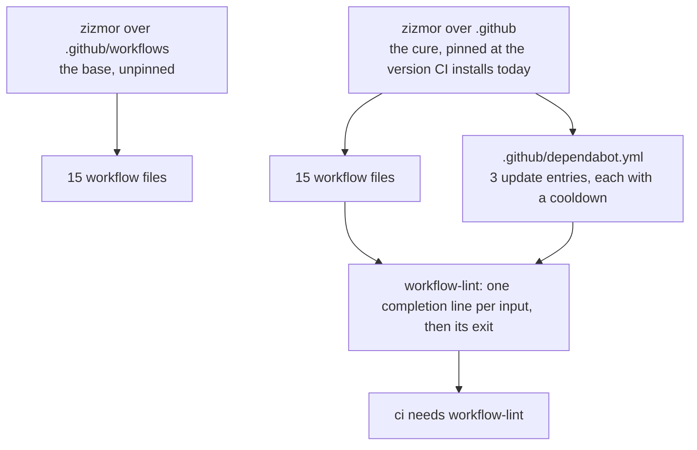
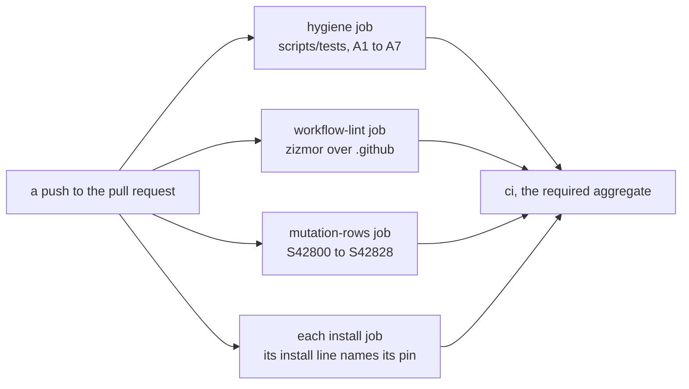

# Schematic: the CI tool pins, the job timeouts and zizmor's inputs, and the checks that hold them (SPEC-428, ADR-442)

Kind: data flow. Every `path:line` below was read at `ac7ebd752f3022da6e5f6b5d7beb5dfc36872e27`;
every count is the one the check prints once the cures land, beside the base's where they differ.

## 1. From the workflow files to the three checks

Each check returns its problems and the populations it examined; the live tests assert the
problems are none, then pass each population through `examined`, which prints `examined N ...`
and refuses 0. The planted tests run the same functions over a copy of the files' text with one
defect each, after the unplanted copy reads clean.

## 2. Each check: its population, its matcher and its counts

| check | population | matcher | examined at the cure (base) |
|---|---|---|---|
| tool pins | every mapping in a read workflow whose `uses`, folded to lower case and cut at `@`, is `taiki-e/install-action` | the `tool` input split on commas and whitespace; each entry a name, `@` and three dot-separated numbers, matched whole; no `tool` input is its own refusal | 20 sites (20), 22 entries (22, of which 10 fail at the base) |
| control for the pins | each line of each file's text, outside comments, whose `uses:` value starts `taiki-e/install-action@` in any case | a count, compared with the sites examined | 20 (20) |
| job timeouts | every job of every read workflow; a job with its own `uses` is a call job, counted apart | the job's own `timeout-minutes` is a digit from 1 to 9 then any digits, matched whole; a step's key is not read | 48 checked (48, of which 2 fail at the base), 4 call jobs (4) |
| zizmor | every line of every `run` value whose first word is `zizmor` | its words equal `zizmor --no-online-audits --persona regular .github`; the inputs its operand reaches include `.github/dependabot.yml` and number the workflow files plus one | 1 command (1), 16 inputs (15 at the base, the Dependabot configuration missing) |
| engine runner | the `engine` job's install steps | an entry, split on commas and stripped, equals the one exact string the pin record `ENGINE_NEXTEST_PIN` holds, `cargo-nextest` at its pin; the bare name and every other version are refused | 1 job (1) |

Every problem line names its file and job: `<file>: <job>: step <n>: <entry> names no exact
version`, `<file>: <job>: step <n>: the install names no tool`, `<file>: <job>: sets no
timeout-minutes`, `<file>: <job>: timeout-minutes is <value>, not a whole number of minutes from
1`, `zizmor runs <n> times across the workflows, not once`, `<file>: <job>: zizmor runs as
<words>, not zizmor --no-online-audits --persona regular .github`, and `zizmor's inputs miss
.github/dependabot.yml`.

## 3. The sites cured

| file:line | job | before | after |
|---|---|---|---|
| `.github/workflows/ci.yml:44` | `rust` | `cargo-nextest,cargo-deny` | each entry at the version job 116733923694 (41m50s) installed |
| `.github/workflows/ci.yml:114` | `engine` | `cargo-nextest` | the version jobs 116733923630 (3m07s) and 116733923715 (2m38s) installed |
| `.github/workflows/ci.yml:166` | `release` | `cargo-nextest` | the version job 116733923753 (41m05s) installed |
| `.github/workflows/ci.yml:318` | `hygiene` | `cargo-deny` | the version job 116733923723 (19m03s) installed |
| `.github/workflows/ci.yml:994` | `workflow-lint` | `zizmor` | the version job 116733923569 (9 s) installed |
| `.github/workflows/ci.yml:996` | `workflow-lint` | operand `.github/workflows` | operand `.github` |
| `.github/workflows/engine-measure.yml:72` | `measure` | `cargo-deny` | the version job 116500686733 (5m10s) installed |
| `.github/workflows/release.yml:183` | `audit-sync-server` | `cargo-deny` | the version the `hygiene` job installed (this workflow has never run) |
| `.github/workflows/rust-cache.yml:58` | `warm` | `cargo-nextest,cargo-deny` | equal to the `rust` site (this workflow has never run) |
| `.github/workflows/changelog.yml:21` | `fragment` | no timeout | `timeout-minutes: 5`, after `runs-on` |
| `.github/workflows/testflight-rerelease-check.yml:17` | `rerelease` | no timeout | `timeout-minutes: 10`, after `runs-on` |

## 4. zizmor's inputs, before and after

`.github/` holds no action definition and no zizmor configuration, so the operand reaches exactly
these 16 inputs; its other files (`CODEOWNERS`, `pull_request_template.md`, the issue templates
and the rulesets) are no input kind zizmor collects.

## 5. Where each check runs

`scripts/tests/test_ci_workflows.py` runs only in CI, so every red and every green above is read
there, by name. The rows on the workflow files are killed by the live checks A1, A3 and A5; the
rows on the helpers by the planted checks A2, A4 and A6 and by the live ones; and the three on
the engine check's coupling, its matcher and the pin record, by A7's plants and the live engine
check.
