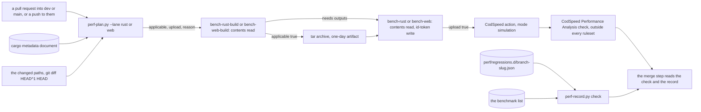

# Schematic: the CodSpeed bench lanes, from the plan to the upload and the record (SPEC-618, ADR-640)

Kind: data flow. Citations read at dev `de4c4d4d`.

Every run of `ci.yml` starts the four bench jobs. Each build job runs the plan, then builds with no
token; its upload job reads the plan's outputs, unpacks the archive and uploads by OIDC. The
aggregate `ci` needs all four (`.github/workflows/ci.yml:1162`, 17 jobs before this delivery).

## The outputs, as the plan writes them

| output | values | read by |
|---|---|---|
| `applicable` | `true` or `false` | the build job's measured steps |
| `upload` | `true` or `false`; `false` on a fork pull request | the upload job's every step |
| `reason` | the first changed path that reaches the lane, the examined count, the push line or the fork line | the upload job's first step and the step summary |

## Where each input comes from

- The changed paths: `--changed <file>`, or `git diff --name-only <base> <head>` in this
  repository, the `fetch-depth: 2` checkout `mutation-web-shard` uses (`.github/workflows/ci.yml:903`).
- The bench closure: the packages with a `bench` target in the `cargo metadata --format-version 1`
  document, and every path dependency they reach.
- The fork test: the head repository the event names, against this repository.
- The token: OIDC on the upload jobs alone; the workflow default stays `contents: read`
  (`.github/workflows/ci.yml:19-20`), as `release.yml` scopes its own grant
  (`.github/workflows/release.yml:36-39`).
