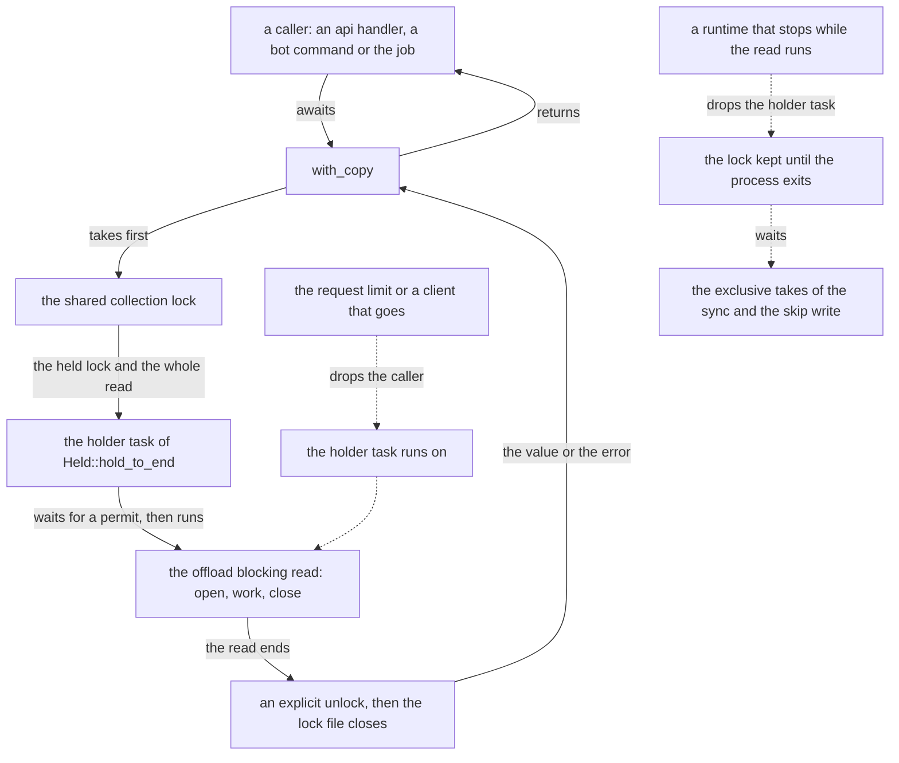

# Schematic: a collection read and its shared lock, from the caller to the read's end

Kind: data flow. Read at DeckStreak dev `bd953ba7` (`crates/ingest/src/reader.rs` `with_copy`,
`crates/ingest/src/lock.rs` `Held::hold_to_end`, `crates/kernel/src/offload.rs` `Offload::run`),
with the read as SPEC-648 changes it. Decided by ADR-671 under ADR-487; built by SPEC-648. The
earlier account of one read, `docs/schematics/sync-cycle-and-change-gate.md`, still holds for the
order of the lock, the offload and the read-only copy; this one adds who holds the lock.

The solid path is a read whose caller waits: the shared lock is taken before anything else, the
holder's task runs the whole read on the offload's blocking thread, and the lock is unlocked
explicitly after the read and the copy's close, then its file closes (SPEC-022 R7). The value or
the error goes back to the caller as before.

The first dotted path is a caller that is dropped mid-read, by the api's request limit or by any
other caller that stops waiting: the holder's task is detached, not stopped, so the read runs to
its end and the lock is released after it. No exclusive holder can take the lock in between.

The second dotted path is a runtime that stops while the read runs: the runtime drops the holder's
task, whose guard keeps the lock (it is never unlocked outside a panic) until the process exits and
the operating system closes the file. The sync's and the skip write's exclusive takes wait for it
(ADR-671, the consequences).
