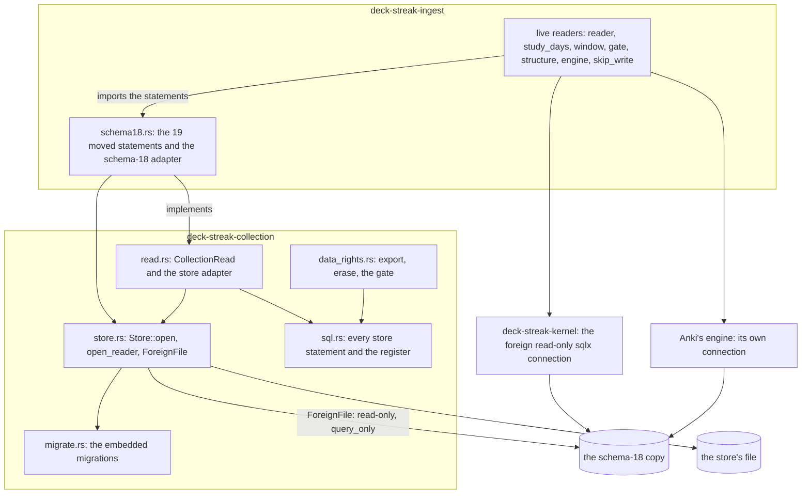

# The collection store and ingest's read port: components (SPEC-512, ADR-530)

The collection crate holds the store and declares the read port; ingest holds the schema-18 adapter beside its live
readers. The live readers keep their own drivers and import the moved statements from the adapter's module.

- `deck-streak-collection` depends on no workspace crate; `deck-streak-ingest` depends on the kernel and on it.
- Only `store.rs` builds a connection; every statement is a registered constant, prepared by the census.
