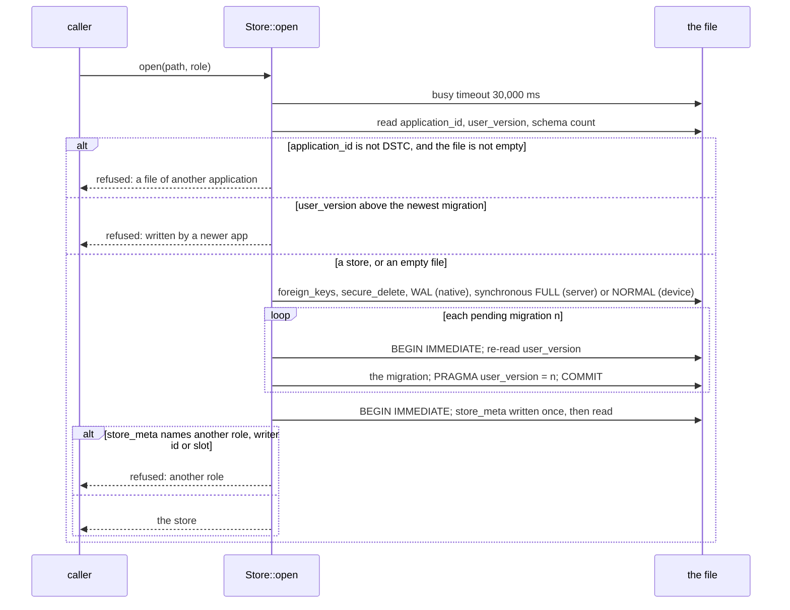

# Opening the collection store: open, check, migrate, refuse (SPEC-512, ADR-530)

`Store::open(path, role)` reads the file's header before it changes anything, so a file it refuses is left byte for
byte as it was.

- `Store::open_reader(path)` takes the same first read, opens read-only with `query_only`, and also refuses a store
  below head.
- `ForeignFile::open_read_only(path)` takes the same first read and refuses the store's own `application_id`.
