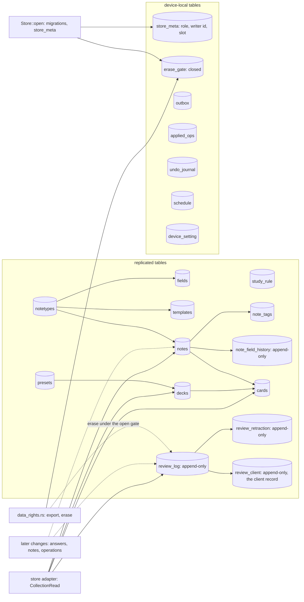

# The collection store's tables: data flow (SPEC-512, ADR-530)

One file per user holds every table below, on the server and on each device. The collection crate is the one writer
of each; nothing live writes or reads them yet (the store is dormant). Dashed arrows are writes later changes make.

- `review_log` rows never change; a row, a retraction, a client record or a history row leaves only while
  `erase_gate` reads open, and only `data_rights.rs` opens it.
- A review row has no foreign key to its card, so a deleted card keeps its history; a retraction and a client record
  each name one review.
- On the server a review row needs its `server_seq`; a device's row may hold none.
