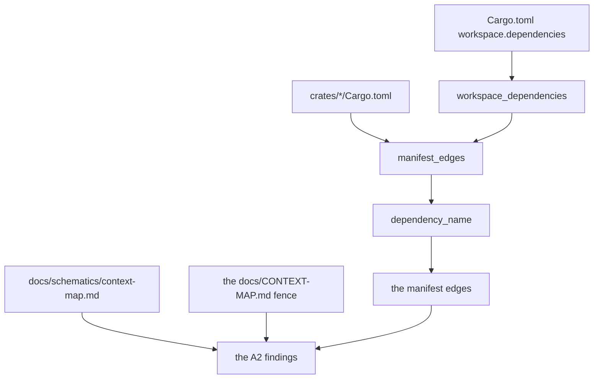

# Schematic: the context-map census and an inherited package rename

Drawn with SPEC-617 and ADR-639, over the census SPEC-394 delivered.

The census in `scripts/tests/test_context_map_schematic.py` parses two kinds of manifest. The root
manifest gives the `[workspace.dependencies]` table, and each crate's manifest gives its entries.
An entry names its crate by its own `package`; else, written `workspace = true`, by the `package`
of its key's entry in the root table; else by its key. The edges it names are compared with the
drawing's arrows and the fence's rows (SPEC-394 A2).

The real tree's reading passes the root table it parsed (SPEC-617 A2), and each fixture passes its
own; no reading takes a default (ADR-639 D2).
