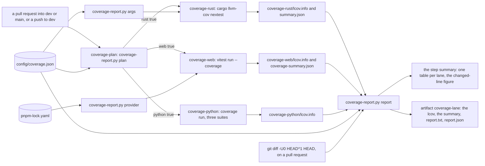

# Schematic: the coverage report, from the lanes to the summary and the artifacts (SPEC-592, ADR-613)

Kind: data flow. Citations read at dev `00dcad26`.

A pull request into dev or main, or a push to dev, starts `coverage.yml`. Its plan picks the lanes;
each lane runs its planted controls, then its tool, then the one report over the one exclusion list.
Nothing here is a required check, and no `needs:` outside this workflow names its jobs
(`.github/rulesets/dev.json:41`, `.github/rulesets/main.json:31`, `.github/workflows/ci.yml:1162`).

## The outputs, as the workflow writes them

| lane | tool output | report output | artifact | kept |
|---|---|---|---|---|
| rust | `$RUNNER_TEMP/coverage-rust/lcov.info`, `$RUNNER_TEMP/coverage-rust/summary.json` | `$RUNNER_TEMP/coverage-rust/report.txt`, `report.json` | `coverage-rust` | 30 days on a pull request, 90 on a dev push |
| web | `$RUNNER_TEMP/coverage-web/lcov.info`, `$RUNNER_TEMP/coverage-web/coverage-summary.json` | `$RUNNER_TEMP/coverage-web/report.txt`, `report.json` | `coverage-web` | the same |
| python | `$RUNNER_TEMP/coverage-python/lcov.info` | `$RUNNER_TEMP/coverage-python/report.txt`, `report.json` | `coverage-python` | the same |

## Where each input comes from

- The lanes and the list: `config/coverage.json`, read by `scripts/coverage-report.py` alone.
- The Rust run: the toolchain pin, untouched (`rust-toolchain.toml:4`), and the restored cache keyed
  on it (`.github/workflows/ci.yml:62`); the timing binary the run leaves out is the one the gate runs
  apart (`scripts/check.sh:39`).
- The web run: the root `vitest.config.ts`, which moves into `web/app` before the plugins load
  (`vitest.config.ts:15`), so the lcov paths are read from `web/app`.
- The Python run: the three suites of the gate python stage (`scripts/check.sh:185`).
- The VOID arms: an lcov that leaves no examined line, an lcov the report cannot read, and in the
  web lane a provider whose locked version differs from vitest. Each exits 1; every other report
  exits 0.
