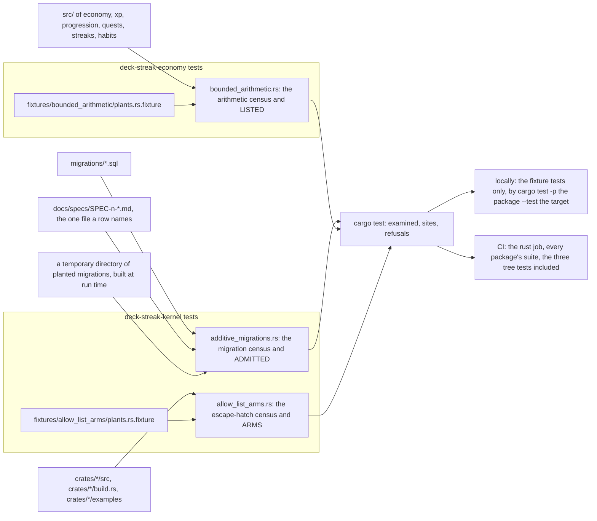
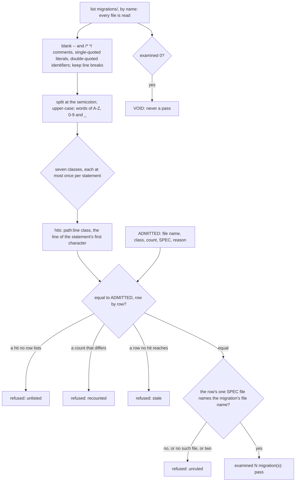
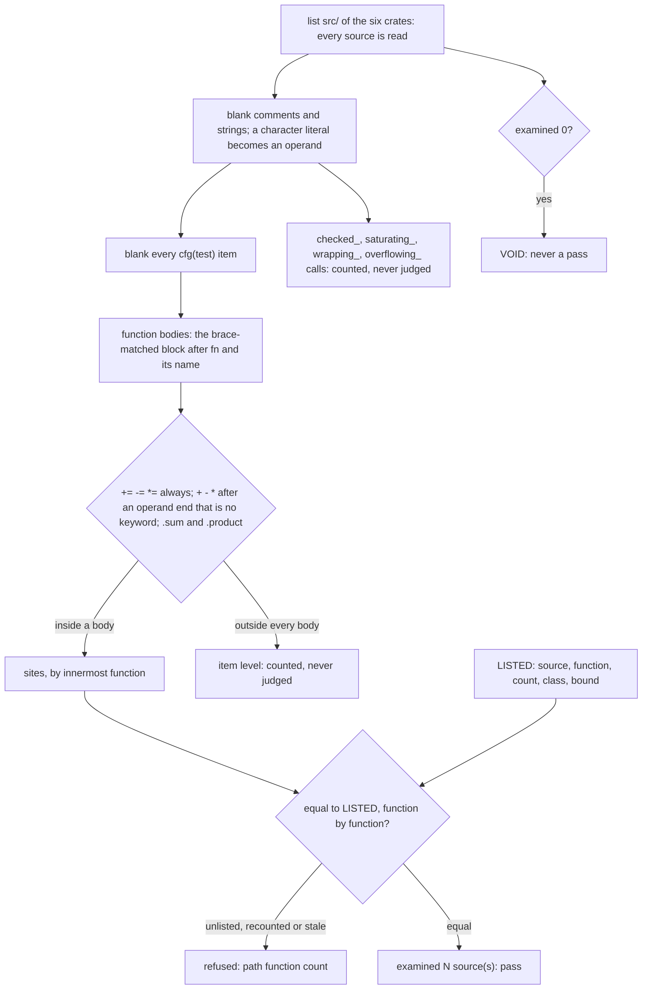
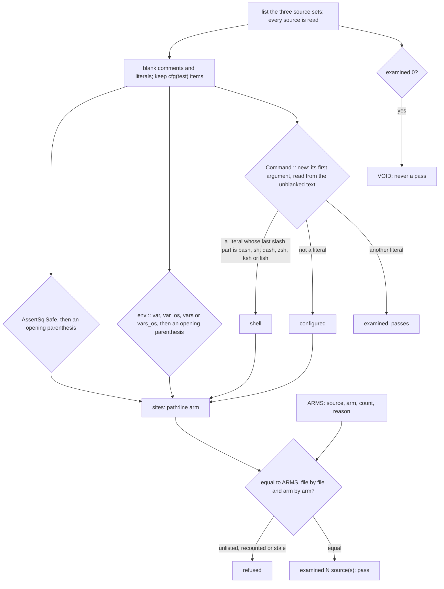

# Schematic: three census tests hold destructive migrations, unchecked money and counter operators, and escape hatches in registers

Kind: component and data flow. Read at DeckStreak dev `b25ed04a`: every `path:line` below is a line
of that commit. Decided by ADR-449; built by SPEC-435.

## 1. The three homes

Each census is a Rust integration test in the crate that owns its rule. Each reads the tree as text
from the repository's root, two levels above its crate, adds no dependency edge, and shares no file
or function with any other census.

## 2. The migration census

Population: every `.sql` file directly in `migrations/`, each read. At `b25ed04a`: 33 files, all
read by the census. The separate reading read 32.

The classes, with the removal verb joined from two parts at run time:

| class | words |
|---|---|
| removes a table | the removal verb, then `TABLE` |
| removes a column | first two words `ALTER TABLE`, and the removal verb anywhere |
| removes an index | the removal verb, then `INDEX` |
| removes a view | the removal verb, then `VIEW` |
| removes a trigger | the removal verb, then `TRIGGER` |
| renames | first two words `ALTER TABLE`, and `RENAME` anywhere |
| deletes rows | `DELETE FROM`, or `OR REPLACE`, or first two words `REPLACE INTO` |

The destructive-change census at `b25ed04a`, by class, over the 32 files the separate reading read:

| class | sites |
|---|---|
| removes a table | `migrations/004102_notifications_queue_claim.sql:31` |
| renames | `migrations/004102_notifications_queue_claim.sql:32` |
| removes a column | none |
| removes an index | none |
| removes a view | none |
| removes a trigger | none |
| deletes rows | none |

The two sites are one `STRICT` rebuild, admitted by SPEC-041 section 8, whose file manifest names
`migrations/004102_notifications_queue_claim.sql`. `migrations/004302_agent_runs_created_at_index.sql:2`
names a delete of rows in a comment, which the blanking removes: no hit.

## 3. The arithmetic census

Population: every `.rs` file under `src/` of the six crates, each read. At `b25ed04a`: 57 sources,
all read by the census and by the separate reading.

Counts at `b25ed04a`: 114 sites in 46 functions, 3 item-level sites and 17 bounded calls. The sites
it lists, by source, function and line (paths under `crates/`):

| source | function | class | lines |
|---|---|---|---|
| `economy/src/rules.rs` | `daily_loss_cap` | Float | 32 |
| `economy/src/rules.rs` | `scaled_fine` | Float | 47 |
| `economy/src/wallet.rs` | `debit_capped_on` | Domain | 559, 560 |
| `economy/src/wallet.rs` | `debit_floored_on` | Domain | 508 |
| `economy/src/wallet.rs` | `movements` | Domain | 185 |
| `economy/src/wallet.rs` | `purchase_on` | Domain | 477 |
| `economy/src/wallet.rs` | `settle_mint_on` | Domain | 433, 434 |
| `habits/src/minutes.rs` | `week_end` | Calendar | 74 (two) |
| `habits/src/minutes.rs` | `week_start` | Calendar | 68 (two) |
| `habits/src/writing.rs` | `streak_ending` | Count | 100, 105, 106 |
| `progression/src/badges/hours.rs` | `local_hour` | Widened | 17 (two) |
| `progression/src/consistency.rs` | `consistency_multiplier` | Float | 65 (two) |
| `progression/src/consistency.rs` | `day_base_xp` | Widened | 35 |
| `progression/src/consistency.rs` | `day_bonuses` | Count | 125 (two), 131 (two) |
| `progression/src/consistency.rs` | `projected_multiplier_drop` | Domain | 75 |
| `progression/src/consistency.rs` | `tier_down_run` | Count | 47, 49 |
| `progression/src/exchange.rs` | `exchange_rates` | Count | 79, 81 |
| `progression/src/level.rs` | `level_info` | Domain | 59 (two), 65 |
| `progression/src/milestone.rs` | `candidate` | Domain | 102, 103 |
| `progression/src/milestone.rs` | `next_milestone` | Domain | 79 |
| `progression/src/milestone.rs` | `smaller` | Domain | 112 (four) |
| `progression/src/records.rs` | `chase` | Domain | 122 |
| `progression/src/xp.rs` | `level_for` | Widened | 82 (four), 83 (two) |
| `progression/src/xp.rs` | `xp_to_reach` | Domain | 95 (three) |
| `quests/src/chests.rs` | `epic_odds_pts` | Domain | 303 (two), 304 (two) |
| `quests/src/chests.rs` | `grant_session_chests_on` | Count | 155, 178 |
| `quests/src/chests.rs` | `payout_xp` | Domain | 337, 345 (four) |
| `quests/src/chests.rs` | `roll_rarity` | Domain | 310, 313, 316, 320, 322 (two) |
| `quests/src/chests.rs` | `sweep_stale_chests_on` | Calendar | 515 |
| `quests/src/draw.rs` | `fraction` | Float | 47 |
| `quests/src/pity.rs` | `after` | Domain | 26, 29, 33, 34 |
| `quests/src/sessions.rs` | `measure` | Count | 98, 100 |
| `quests/src/sessions.rs` | `session_bounds` | Calendar | 65 |
| `quests/src/tokens.rs` | `activate_token_on` | Calendar | 147 (two) |
| `streaks/src/calendar.rs` | `first_day` | Calendar | 51, 52 (two) |
| `streaks/src/calendar.rs` | `language` | Calendar | 98 |
| `streaks/src/calendar.rs` | `law` | Calendar | 136 |
| `streaks/src/freeze.rs` | `civil_month` | Calendar | 12, 15 (three), 16 (four), 17 (two), 18 (two), 19 (three) |
| `streaks/src/freeze.rs` | `freeze_events_for` | Widened | 112 (two) |
| `streaks/src/governor.rs` | `silence_walk` | Calendar | 126 |
| `streaks/src/governor.rs` | `standby_notice` | Calendar | 74 |
| `streaks/src/law.rs` | `bridged_streak` | Calendar | 27 |
| `streaks/src/store.rs` | `add_freeze` | Domain | 264 |
| `streaks/src/strength.rs` | `advance` | Float | 20 (four) |
| `streaks/src/strength.rs` | `persists` | Calendar | 43 |
| `xp/src/review_xp.rs` | `review_xp` | Domain | 65, 80 (four) |

The register holds a function's count and never its lines, so an edit that moves a site within its
function keeps the census green, and a new site in any function fails it.

## 4. The escape-hatch census

Population: every `.rs` file under `crates/*/src/`, every `crates/*/build.rs` and every `.rs` file
under `crates/*/examples/`, each read. At `b25ed04a`: 349 sources, all read by the census. The
separate reading read 341. Test modules under `src/` are examined.

The sites it lists at `b25ed04a`, 12 in 11 rows, and the one spawn that passes, in the 341 sources
the separate reading read:

| arm | site | owner |
|---|---|---|
| sql-escape | `crates/ingest/src/reader.rs:372` | SPEC-023 R1 |
| shell | `crates/agent/src/runner.rs:104` | ADR-043 |
| configured | `crates/daemon/src/snapshot_lister.rs:110` | the archive's list command, from configuration |
| configured | `crates/vault/src/staged.rs:486` | the vault gate's configured interpreter |
| configured | `crates/ingest/src/skip_write/tests.rs:46` | a test module re-runs its own binary |
| env-read | `crates/daemon/src/main.rs:100` | SPEC-020 R10 |
| env-read | `crates/ingest/src/skip_write.rs:989` | SPEC-083, the zone pin |
| env-read | `crates/ingest/src/skip_write/tests.rs:34` | the re-run child's role |
| env-read | `crates/progression/build.rs:13` | the build script's census switch |
| env-read | `crates/fsrs7/examples/replay_report.rs:37` | a CI step's summary file |
| env-read | `crates/ingest/examples/engine_probe.rs:90`, `:92` | the example's own `main` |
| passes | `crates/agent/src/gate.rs:118` | a literal `python3`, examined and not listed |

## 5. Where each runs, and what a red reads

| census | read locally and in CI (fixtures and temporary trees) | read in CI only (the real tree) |
|---|---|---|
| migrations | A1, A2, A3, A5: `cargo test -p deck-streak-kernel --test additive_migrations -- --exact <test>` | A4, in the `rust` job |
| arithmetic | A6, A7, A9: `cargo test -p deck-streak-economy --test bounded_arithmetic -- --exact <test>` | A8, in the `rust` job |
| escape hatches | A10, A11, A13: `cargo test -p deck-streak-kernel --test allow_list_arms -- --exact <test>` | A12, in the `rust` job |

At the red commit each census is a stub that reads nothing and accepts every register, so all
thirteen tests are red: the ten fixture tests locally and in CI, the three tree tests in CI. A
site the census finds in a file the separate reading did not read turns A4 or A12 red in CI by its
`path:line` and class. A sibling pull request that moves a population (a new
migration, a new source in the six crates, a new spawn or environment read) moves a census's
count, and the census fails until the same pull request updates its register.
