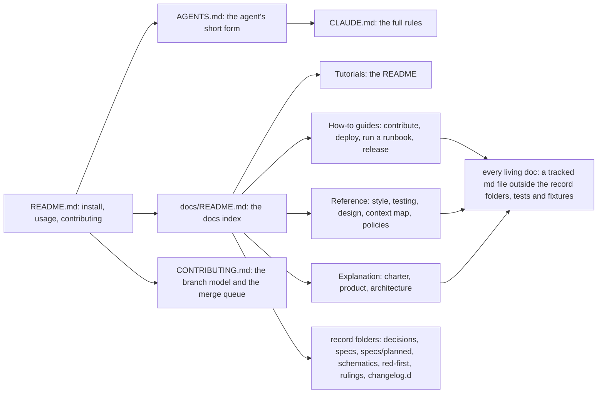
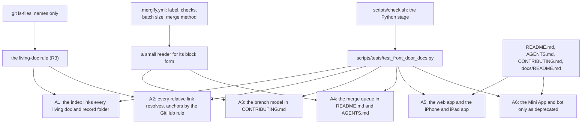

# The front door, the docs index and the gate's docs check

A data-flow schematic of SPEC-622 (ADR-644). Every `path:line` citation was read at dev `8620664`;
the new paths are SPEC-622's.

## 1. The docs map

A reader enters at `README.md`, which links the docs index; the index links every living doc and
each record folder (R3). `AGENTS.md` is the agent's entry and points at `CLAUDE.md` and the same
index through the README.

## 2. The gate's flow

`scripts/check.sh` lines 185 to 186 run `python3 -m unittest discover` over `scripts/tests`, so the
new module joins the Python stage with no workflow change (R4). The queue file feeds A3 and A4, so
the merge queue text follows `.mergify.yml`.

## 3. What each test opens

Only living docs are opened, and a link's target only when its destination carries a fragment
and the target is a Markdown file; every other target is judged by its name in the tracked list.
A planted tree in a temporary folder takes the same functions with its own name list, so the planted
controls need no git.
