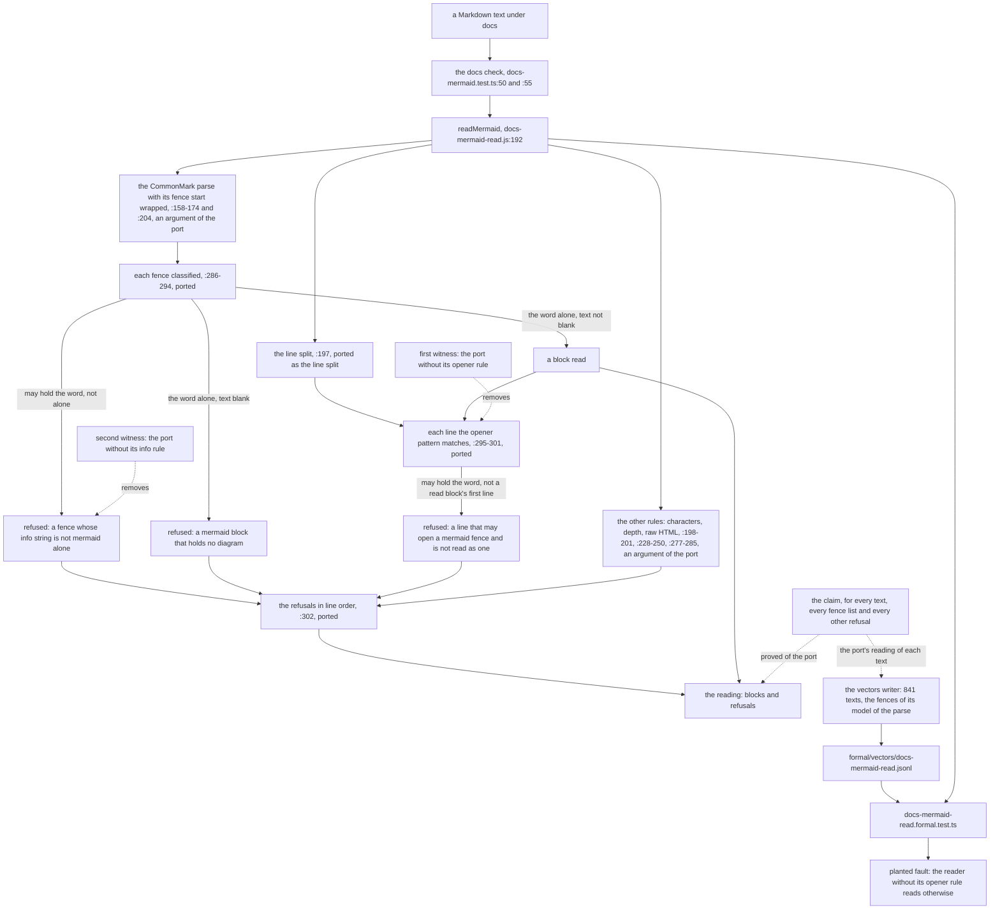

# The docs Mermaid reader and its Lean statement

- **Kind:** data flow.
- **Owns:** the path from a Markdown text through the docs check's reader to each `mermaid` fence
  it reads or refuses by name, and the Lean statement and vectors that hold that path (SPEC-474,
  ADR-491). The reader and its check are SPEC-195's (ADR-195, #383).
- **Read at:** every `path:line` below was read at `36c4783a`. Paths under `web/app/src/lib/` are
  shortened to the file name, and a bare `:n` is a line of `docs-mermaid-read.js`.

## 1. From a text to each fence read or refused

The parse finds every fence; the reader's own line scan (`:296-301`) only names the lines the
parse did not open as a read block. So a fence the parse leaves unclosed is closed at the document's
end and classified like any other, and a marker indented four columns or more, a marker inside
another fence's body, and a backtick fence whose info string holds a backtick open no fence and
reach only the opener rule, which names each.

## 2. The statement's functions, step by step

| step | the reader | the statement (`formal/lean/Formal/DocsMermaidRead.lean`) |
|---|---|---|
| split the text at each line end | `:197`, with `LINE_END` at `:89` | ported: the line split over characters |
| find each fence and its raw info string | the parse, `:158-174` and `:204` | not ported: the fence list is an argument, and the claim holds for every list |
| refuse characters, depth and raw HTML | `:198-201`, `:228-230`, `:248-250`, `:277-285` | not ported: those refusals are an argument, kept and never examined |
| may an info string hold the word | `MERMAID_INFO`, `:66` | ported: the word in any ASCII letter case, or a `&` |
| is it the word alone | `MERMAID_WORD`, `:69` | ported: blanks, the word, blanks |
| is a fence's text blank | `:291` | ported: no character outside the blank set |
| classify each fence | `:286-294` | ported: a block, one of two names, or nothing |
| may a line open a fence | `OPENER`, `:104`, with `FENCE_PREFIX` at `:58` | ported: the prefix, then three or more backticks or tildes, then the info string |
| name each such line not read | `:295-301` | ported: the opener rule |
| order the refusals | `:302` | ported: a stable sort by line |
| the claim | (none) | `every_line_that_may_open_a_mermaid_fence_is_read_or_refused_by_name`, at `ramp=report` |

## 3. The vectors, from the statement to the web test

1. The writer, `formal/lean/Formal/DocsMermaidReadVectors.lean`, holds 841 texts: every text of
   one to three lines over nine lines (819) and 22 named texts (SPEC-474 R5).
2. For each text it takes the fences its model of the parse opens in a text with no container,
   and prints the port's reading with no other rules' refusals: the text's blocks and refusals.
3. `formal/lean/Formal/Vectors.lean`'s `main` runs it by one arm, and its output is
   `formal/vectors/docs-mermaid-read.jsonl`, a header line and 841 vector lines. The formal checker
   compares the file with the writer's output byte for byte.
4. `web/app/src/lib/docs-mermaid-read.formal.test.ts` reads the file, finds the root by
   `pnpm-workspace.yaml`, and asserts that `readMermaid` reads each text as its vector says. A
   vector read otherwise names the reader, the port or the model as wrong, and the file is then
   written again by the writer, never edited.

## 4. The planted fault and the witnesses

| what | where | caught by |
|---|---|---|
| the reader without its opener rule (`:295-301` removed) | first witness, `the_reader_without_its_opener_rule_leaves_a_mermaid_line_unnamed`, at `witness.opener-in-a-tilde-fence` | the formal checker: the witness proves the claim false of that port |
| the same fault in the shipped reader's reading | the web test's `once its opener rule is removed` | the web suite: that reader reads otherwise than the vectors at the same text |
| the reader without its info rule (the refusal at `:289` removed) | second witness, `the_reader_without_its_info_rule_leaves_a_mermaid_fence_unnamed`, at `refused.capital-letter` | the formal checker |

## 5. What the path does not hold

- The parse itself, and so a container's fences: the docs check's generated population judges
  those (SPEC-195 A5).
- The other rules' decisions: the claim keeps their refusals and states nothing about when they
  fire.
- An edit to the reader that changes no vector's reading: no cover names the reader until the
  shared formal checker admits one on a web file (ADR-491, Consequences).
