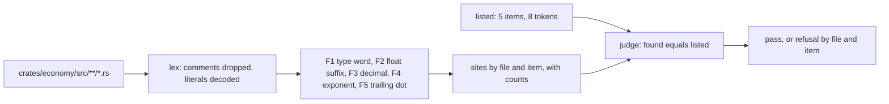
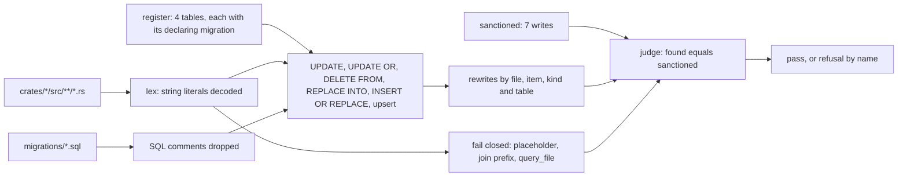
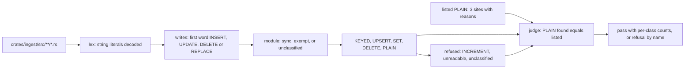

# Domain integrity checks: integer money, append-only tables and sync write idempotency

Three source censuses, each a Rust integration test that reads the committed tree, decodes Rust
literals with the shared lexer (`tools/table-census/table_census.rs::lex`), prints what it examined
and fails on any site its list does not hold (SPEC-432, ADR-446). Every `path:line` below was read at
`b25ed04a`.

## 1. Integer money (data flow)

- **Population:** every `.rs` file under `crates/economy/src/` (6 at `b25ed04a`). Printed:
  `examined <n> source file(s)` and `examined <n> token(s)`; either at 0 is VOID.
- **Matcher:** the five rules of ADR-446 D1 over the token stream; each hit is named by the item
  after the last item keyword before it.
- **Listed at `b25ed04a`:** `constants.rs` `DAILY_LOSS_CAP_WALLET_FRAC` 2 (line 14),
  `FINE_WALLET_FRAC` 2 (line 16), `PASS_SURCHARGE_MULT` 2 (line 24); `rules.rs` `daily_loss_cap` 1
  (line 32) and `scaled_fine` 1 (line 47).
- **Where it runs:** `cargo test -p deck-streak-economy --test integer_money`, in CI's workspace
  run.

## 2. Append-only tables (data flow)

- **Register:** `coin_ledger` (`migrations/008201_economy_wallet_and_shop.sql`), `xp_ledger`
  (`migrations/004001_progression_xp_ledger.sql`), `badges_earned`
  (`migrations/007301_progression_badges_earned.sql`), `band_milestones`
  (`migrations/007701_curriculum_road_to_c2_and_law.sql`).
- **Population:** every crate's `src` and every migration. Printed: `examined <n> source file(s)`,
  `examined <n> literal(s)`, `examined <n> migration(s)`; any at 0 is VOID.
- **Listed at `b25ed04a`:** `crates/economy/src/wallet.rs:439` `settle_mint_on` UPDATE
  `coin_ledger`; `crates/economy/src/data_rights.rs:106` `erase` DELETE `coin_ledger`;
  `crates/progression/src/data_rights.rs:142` and `:151` `erase` DELETE `xp_ledger` and
  `badges_earned`; `crates/curriculum/src/data_rights.rs:134` `erase` DELETE `band_milestones`;
  `crates/coordination/src/recompute/badges.rs:198` `offer_badges` UPDATE `badges_earned`;
  `crates/curriculum/src/store.rs:386` `mark_band_up` UPDATE `band_milestones`.
- **Where it runs:** `cargo test -p deck-streak-daemon --test append_only_tables`. The composition
  root hosts it because the register names three contexts' tables.

## 3. Sync write idempotency (data flow)

- **Modules:** sync `skip.rs`, `state.rs`, `sync_runs.rs`; exempt `data_rights.rs` (the owner's erase
  and export), `sensitive.rs` (the owner's sensitive-deck marks), `write_class_stop.rs` (the owner's
  stop).
- **Population:** every `.rs` file under `crates/ingest/src/`. Printed: `examined <n> module(s)`,
  `examined <n> literal(s)`, `examined <n> sync write(s)` and one count per class; any population at
  0 is VOID.
- **Classes at `b25ed04a`:** UPSERT 4 (`state.rs:195`, `:222`, `:251`, `:291`), KEYED 1
  (`skip.rs:363`), SET 4 (`skip.rs:409`, `:563`, `:588`, `:689`), PLAIN 3, DELETE 0, INCREMENT 0.
- **Listed PLAIN at `b25ed04a`:** `skip.rs:657` `record_prior` (the key `UNIQUE (skip_id, card_id)`
  refuses a second row and the write rolls back); `sync_runs.rs:368` `record_skipped` and
  `sync_runs.rs:432` `record` (an event record whose table's one unique key is its row id).
- **Where it runs:** `cargo test -p deck-streak-ingest --test sync_write_idempotency`.

## 4. What each check leaves to others

- The engine's writes, which carry no SQL, are held where they may be called by
  `crates/ingest/tests/skip_census.rs` and modelled by `formal/tla/SkipDayWrite`.
- Which crate may name `coin_ledger` or `xp_ledger` at all is the wallet and ledger censuses'
  (SPEC-324).
- Rust outside `src` is read by no census (#585).
