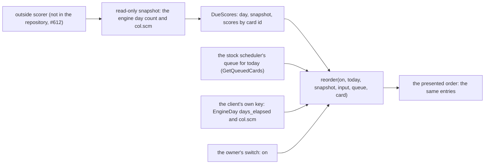
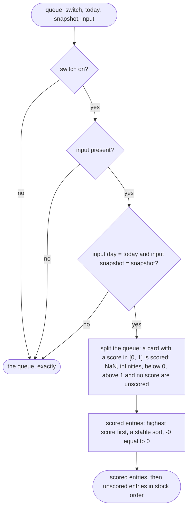
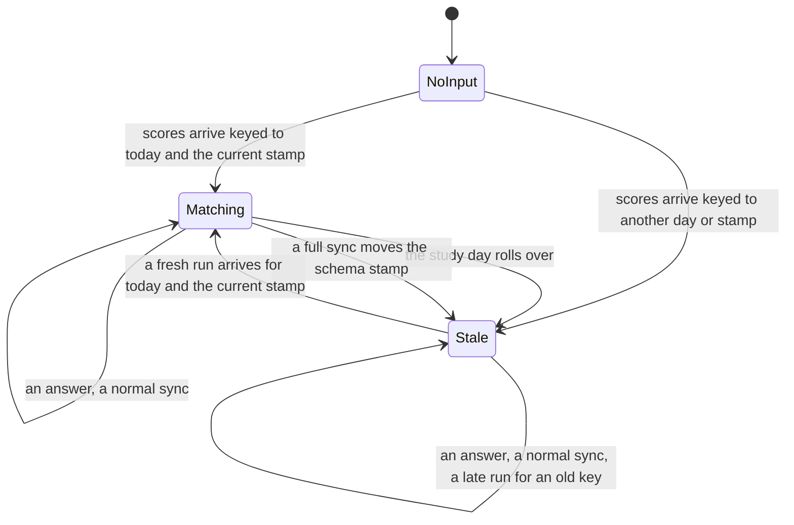

# The due-card scores input and the one reorder

SPEC-414 and ADR-428 (#824), over ADR-339. Every `path:line` below is read at DeckStreak `dev`
`c74b6b9684bf24dc56a83c7005afd52064d2632c`; `crates/engine-core/src/reorder.rs` is added by this delivery.

## 1. Data flow: from an outside scorer to the presented order

A scorer outside the repository reads a snapshot of the collection, read-only, and publishes one score per
card due on a study day, keyed by that study day and by the snapshot's schema stamp. The client builds the
day's stock queue with the stock scheduler, and the core's one pure function orders it. Nothing on this path
writes a card field: the reorder takes the queue's entries by value and gives the same entries back.

The client's side of the key and the switch are the wiring's (#630 on the web, #632 on iPhone and iPad). Today
both web readers of the queue's head ask for one card in the stock order (`crates/web-engine/src/wasm.rs:263-265`,
`:723-726`), and no score reaches them.

## 2. The decision inside `reorder`

## 3. State: the input the client holds across a day

The key is what makes a stale input harmless. A scorer run keyed to day 1 can arrive after the rollover to day
2, or after a full sync replaced the collection; whenever it arrives, its key no longer matches the client's,
and the reorder returns the stock queue. Clearing the input at the rollover cannot do this, because the late
arrival lands after the clear (`tla/DueReorderInput`, the witness
`scores-apply-only-on-their-own-day-and-snapshot.cfg`).

In `Matching` the switch decides between the reordered and the stock order; in `NoInput` and `Stale` the
presented order is the stock order whatever the switch says.

## 4. Who names the input

The register of ADR-428 D7: `crates/engine-core/src/reorder.rs` alone names `DueScores` among the core's
sources and the two client adapters' sources (`crates/ffi/src`, `crates/web-engine/src`), and it names no
engine crate and no other module of the core. A wiring delivery adds its own file to the register in the same
change that names the input.
