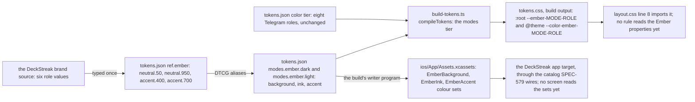

# Ember tokens: one source, two copies, one census

A data-flow schematic of SPEC-578 (ADR-597). Every `path:line` citation was read at dev `57cbb5e1`;
the new paths are SPEC-578's.

## 1. Where each role value goes

## 2. Each step, its proof, its red and its row

| step | what holds it | red planted | row |
|---|---|---|---|
| raw colours in `ref.ember` agree with their components | the compile's existing sRGB check (`build-tokens.ts:90-112`) | a component that makes another byte fails the compile (kept) | none |
| the `modes` tier has both modes and the three roles | A2, `tokens.test.ts`; A6, `test_ember_tokens.py` | a role deleted from the light mode, then from the dark mode; a seventh role added | none (TypeScript: StrykerJS) |
| the compile emits six properties with the tokens' hex and maps each into Tailwind's theme | A1, `tokens.test.ts` | at the base the compile ignores `modes`, so no `--ember-` property exists | none (TypeScript: StrykerJS) |
| ink and accent on the background reach 4.5:1 in both modes | A3, `tokens.test.ts` | at the base no Ember token exists to judge | none |
| each colour set's light and dark entries equal their tokens | A4, A5, `test_ember_tokens.py` | a colour set whose dark entry differs by one byte; a set missing its dark entry | S57801 (the light background hex in `tokens.json`), S57802 (EmberInk's dark red byte), S57803 (EmberAccent's light green byte) |
| no raw colour literal outside the route | A7, `test_ember_tokens.py` | a planted Swift file holding `Color(red: 1, green: 0, blue: 0)`; a planted hex in a copy of `layout.css` | none |
| a complete planted set reads green | A8, `test_ember_tokens.py` | the control | none |
| the Telegram roles and their contrast proof are unchanged | SPEC-028 A8 and A9 | not red: kept checks | none |

## 3. What the census reads

`scripts/tests/test_ember_tokens.py` reads, from the root it is given:

- `web/app/src/lib/design/tokens.json`: the `modes.ember` roles, each alias resolved through
  `ref`, as six hex values; it refuses a mode or a role that is missing.
- `ios/App/Assets.xcassets/<Name>.colorset/Contents.json` for `EmberBackground`, `EmberInk` and
  `EmberAccent`: the entry with no appearance and the entry whose `luminosity` appearance is `dark`,
  each component's 8-bit hex; it refuses a set, an entry or a value that is missing or differs.
- `web/app/scripts/build-tokens.ts`, `web/app/src/routes/layout.css` and every `*.swift` under
  `ios/App/Sources/`: it refuses a hex colour, an `rgb(`, `hsl(` or `oklch(` call, and a Swift
  `Color(red:`, `UIColor(red:`, `Color(.sRGB` or `Color(hue:` call.

Each read prints its examined count and refuses zero: six roles, three sets of two entries, and the
number of files the literal scan read.

## 4. What stays as it is

The `color` tier and its Telegram mapping (`tokens.json` lines 22 to 67), `layout.css`, every
screen, the harness's catalog (`ios/Harness/Assets.xcassets`), the bot and the Mini App.
