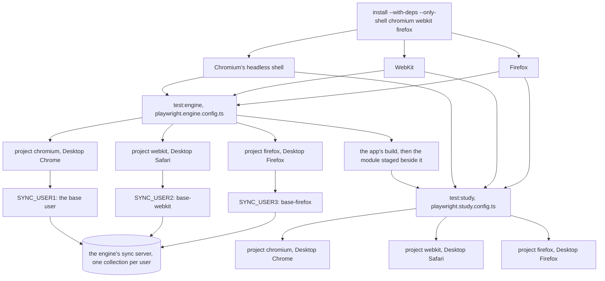

# Schematic: the engine and study suites run in Chromium, WebKit and Firefox in the web-engine job

Kind: data flow (the `web-engine` job from its install line to its two suite steps, each suite's
configuration with its three projects, and the engine suite's three sync users). Read at DeckStreak
`b065fce` (`.github/workflows/ci.yml`, `web/app/playwright.engine.config.ts`,
`web/app/playwright.study.config.ts`, `web/app/tests-engine/sync.spec.ts`). Decided by ADR-635;
built by SPEC-613.

## 1. Before: two engines

At `b065fce` the job installs Chromium's headless shell and WebKit on one line
(`ci.yml:1091-1092`), runs the engine suite (`:1093-1094`) and then, over the staged build, the
study suite (`:1103-1104`). Each configuration declares `chromium` and `webkit`
(`playwright.engine.config.ts:37-40`, `playwright.study.config.ts:19-22`), and the engine suite's
sync server has two users (`playwright.engine.config.ts:58-59`).

## 2. After: three engines from the same line

The projects of each configuration run one after another in one worker, each test in a persistent
profile of its own. The server reads `SYNC_USER1` onward until the first missing index, so the
three entries are numbered from 1 without a gap.

## 3. The account rule

`account()` in `sync.spec.ts` gives a project its server user: `chromium` the base user, any other
project the base user with `-<project>` after it. The engine configuration's entries make exactly
those users, one per project, so no project's uploads reach another's collection (SPEC-377 A1 to
A3).

| project | `account()` gives | its entry |
|---|---|---|
| `chromium` | the base user | `SYNC_USER1` |
| `webkit` | the base user, then `-webkit` | `SYNC_USER2` |
| `firefox` | the base user, then `-firefox` | `SYNC_USER3` |

## 4. What holds each part

- The three projects of each configuration, in order, each on its desktop device: SPEC-613 A1, and
  the study coverage test's device pin.
- Every engine installed before each suite step: SPEC-613 A2.
- One server user per engine project, and `account()` mapping each to its entry: SPEC-613 A3.
- Every test that runs in Firefox passing under `[firefox]`, and the job's time against its bound:
  SPEC-613 A4 and A5, read in the second push's `web-engine` job.
