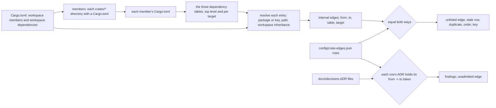
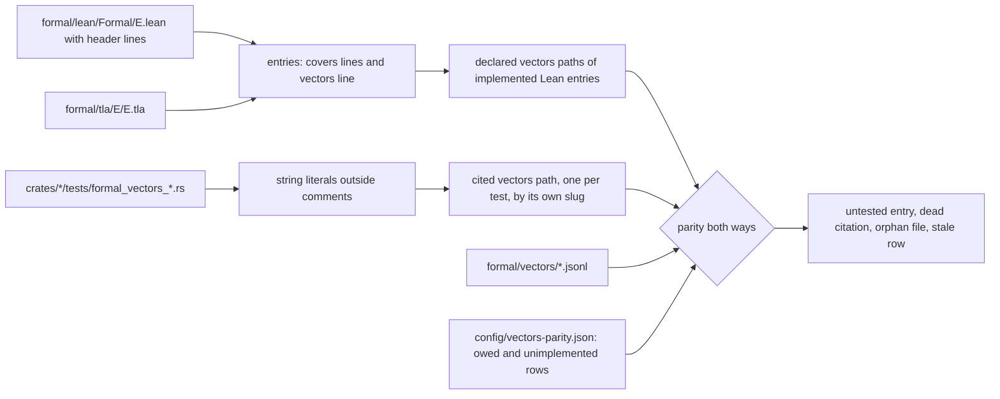
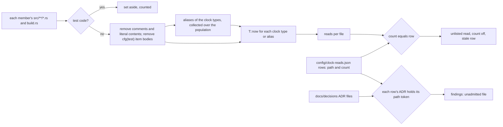

# Schematic: three fitness tests, each a census over a listed file

Kind: data flow. Read at DeckStreak `dev` b25ed04ab10f24a89a1ec0eed71f8a365f411521.
SPEC-431 and ADR-445 decide what each census reads and refuses.

Each census reads committed files only, starts no process, and runs where the repository's other
censuses run: CI's run of every `scripts/tests/test_*.py` module. Each test judges the real tree
first, then prints what it examined (0 is VOID), then refuses each planted defect by name. A list
row is admitted only by an ADR file whose text names the row's token.

## 1. The crate graph: `scripts/tests/test_crate_edges.py`

| what | at `dev` | printed as |
|---|---|---|
| population | 31 members, all named `deck-streak-<name>` | `examined 31 member manifest(s)` |
| internal edges | 85: 85 `dependencies`, 0 `dev-dependencies`, 0 `build-dependencies`; 1 under `cfg(target_arch = "wasm32")` | `examined 85 manifest edge(s)` |
| rows | 85, each citing ADR-445, whose appendix names each `from -> to` | `examined 85 edge row(s)` |
| matcher | an entry is internal when its resolved package names a member or its resolved path is a member's directory | the planted controls of A1 to A3 |
| not seen | a `#[path]` or `include!` reach into another member's source; a `[patch]` aimed at a member | ADR-445 D1 |

## 2. Formal-to-code parity: `scripts/tests/test_formal_parity.py`

| what | at `dev` | printed as |
|---|---|---|
| entries | 40: 13 Lean (each with covers and one vectors line), 27 TLA+ (each with covers, no vectors) | `examined 40 formal entry(ies)` with the Lean and TLA+ counts |
| vectors tests | 11, each naming its path once in a string literal | `examined 11 vectors test(s)` |
| vectors files | 13, each declared by one Lean entry | `examined 13 vectors file(s)` |
| rows | `owed`: `lean/SensitiveDeck`, `lean/TableCensusReach`; `unimplemented`: none | `listed 2 parity row(s)` |
| matcher | the token is `formal/vectors/<slug>.jsonl` inside a string literal, never in a comment | the planted controls of A4 and A5 |

## 3. The clock-read allow-list: `scripts/tests/test_clock_reads.py`

| what | at `dev` | printed as |
|---|---|---|
| population | every `.rs` under a member's `src/` and its `build.rs`, less test code | `examined <n> production Rust file(s)` and `set aside <n> test file(s)` |
| test code set aside | `crates/ingest/src/skip_write/tests.rs` and `crates/vault/src/unicode_other_tests.rs` (declared under `#[cfg(test)]`), plus every `tests/`, `examples/` and `benches/` file | the second line above |
| reads | 7 in 6 files | `examined 7 clock read(s)` |
| rows | `crates/agent/src/runner.rs` 1, `crates/daemon/src/snapshot_lister.rs` 1, `crates/ffi/src/engine.rs` 1, `crates/ingest/src/skip_write.rs` 2, `crates/kernel/src/clock.rs` 1, `crates/web-engine/src/wasm.rs` 1 | `examined 6 clock row(s)` |
| not seen | an `.elapsed()` on a `SystemTime`; a macro that builds the path from its arguments; a production file included by `#[path]` from outside `src/` | ADR-445 D3 |

## 4. Where each runs and what each owes

| census | module | list | rows | kill criteria |
|---|---|---|---|---|
| crate graph | `scripts/tests/test_crate_edges.py` | `config/crate-edges.json` | S43100 to S43114 | ADR-445 D6, over the last 30 merged pull requests |
| formal parity | `scripts/tests/test_formal_parity.py` | `config/vectors-parity.json` | S43115 to S43122 | the same |
| clock reads | `scripts/tests/test_clock_reads.py` | `config/clock-reads.json` | S43123 to S43133 | the same |

None of the three changes `scripts/tests/test_context_map_schematic.py`,
`scripts/tests/test_xp_crate_graph.py`, the fence in `docs/CONTEXT-MAP.md` or
`config/formal.json`, which keep holding what they hold.
