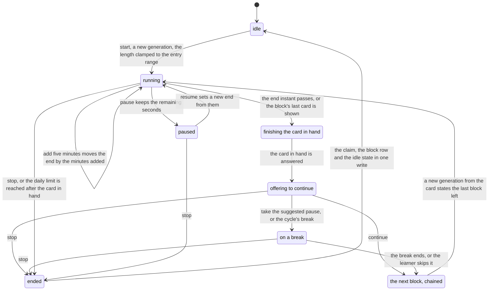
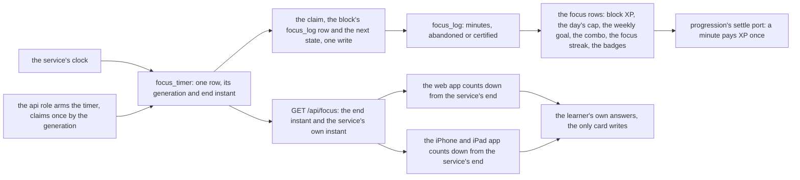
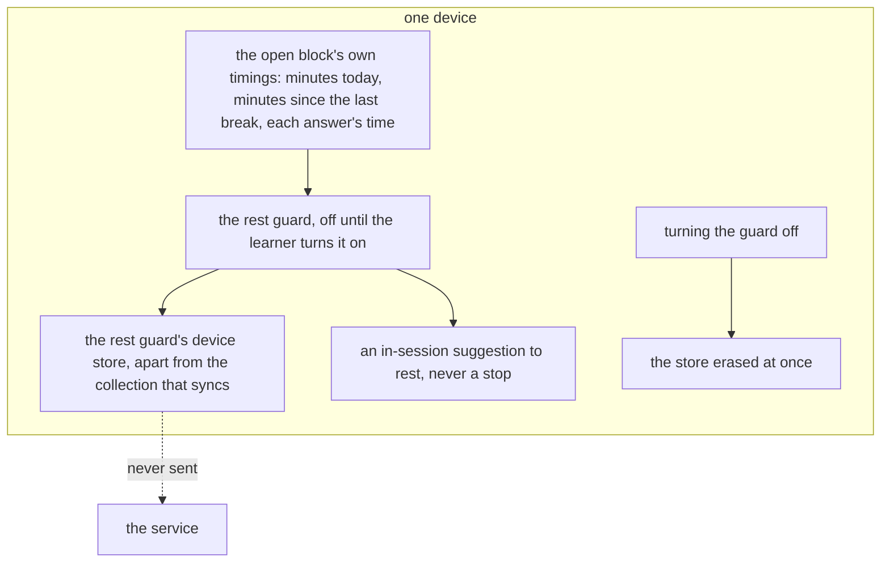

# Schematic: a focus block in the study clients, and its one timer

Kind: state machine and data flow. Read at DeckStreak `dev` from `crates/focus/src/lib.rs`,
`web/app/src/routes/study/+page.svelte`, `ios/App/Sources/ReviewView.swift`, ADR-079 and
`docs/schematics/focus-timer-state-machine.md`. Added by SPEC-607 (ADR-628, ADR-629).

## The block's states

A block runs in the web app or the iPhone and iPad app, on the service's one timer row. Its length
counts minutes or cards. The end is soft: the card in hand is finished before the block offers to
continue, and a card is never taken off the screen mid-answer. A block writes nothing to a card
beyond the learner's own answers.

| state | what the client shows | what the service holds |
|---|---|---|
| idle | the picker: presets or a typed length, in minutes or in cards | the row idle |
| running | the block's own time left and its progress, never a date, a day count or days left | the row running, its generation, its end instant |
| paused | the time left, held | the remaining seconds |
| finishing the card in hand | the card, untouched | the block claimed at its end, its row in the focus log |
| offering to continue | continue, a pause, or stop; no copy urges | the row idle, or a cycle's next block |
| on a break | the break's own time left | a break block; the scheduler's clock runs on for cards waiting on a learning step |
| ended | the block's result, from the service's answer | the claim, the block's row and the next state, committed together |
| the next block, chained | a new block from the card states the last one left | a new generation; due cards the last block did not reach stay due |

A block counted in cards reaches its soft end when its last card is shown, and the client reports
the count reached; the service claims it by the generation, as a stop claims. Its fallback end
instant is the entry cap after its start.

## The one timer, from the service's clock to both clients

The deprecated bot role arms no focus timer, and the Mini App has no block screen.

## Where the rest guard's store sits

The rest guard reads nothing from a health store or from any other app's data, and no request
either client sends carries a reading (ADR-629).
