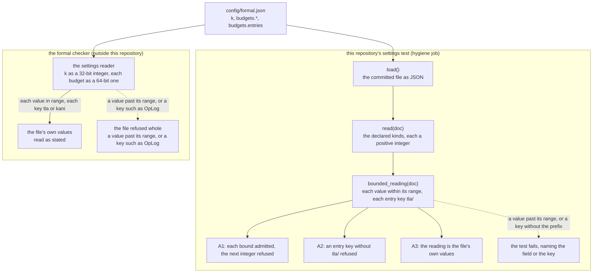

# The formal check's bounded settings: from the settings file to the checker's range

- **Kind:** data flow.
- **Read at:** the development branch's commit `b065fce`; every `path:line` below is at that commit.
- **Decided by:** ADR-633 (SPEC-611, issue #802).

## The flow

The settings file states `k`, three budgets and the per-entry budgets. Two readers take them: the
formal checker, outside this repository, which reads each value within its integer range and
refuses the whole file otherwise; and this repository's settings test, which reads them through
`load` and `read` and then holds them to the checker's range and prefix by `bounded_reading`.
Solid edges are the agree path; dotted edges are the ways the two readings can part, each ending
where it is observed.

## Agree and disagree

| case | the settings test | the formal checker | observed by |
|---|---|---|---|
| each value within its range, each per-entry key starting `tla/` | admits it; the bounded reading is the file's own values | reads the file's own values as stated | A1, A2 and A3 green |
| a value past its range (a `k` above 4294967295, a budget or a per-entry budget above 18446744073709551615) | refuses it by the bounded rule's range arm, naming the field | refuses the file whole | A1, before any check reads the file |
| a per-entry key such as `OpLog`, with neither `tla/` nor `kani/` | refuses it by the bounded rule's entry arm, naming the key | refuses the file whole | A2, before any check reads the file |
| a per-entry key starting `kani/` | refuses it by the bounded rule's entry arm, naming the key | reads it as a Kani entry's budget | the settings test itself; the one disagree row, by ADR-633 D2 |
| a value that is not a positive integer | refuses it by `read`, as before this delivery | refuses the file whole | SPEC-295's planted faults |

## Where each step lives

| step | where, at `b065fce` |
|---|---|
| the values | `config/formal.json:2-21` |
| the test's field table | `scripts/tests/test_formal_config.py:53-57` |
| the test's reader | `scripts/tests/test_formal_config.py:152-191` (`read`) |
| the slot rule | `scripts/tests/test_formal_config.py:194-218` (`slot_reading`) |
| the bounded rule | `scripts/tests/test_formal_config.py`, `bounded_reading`, added by SPEC-611 after the slot rule; its two cases in the class `BoundedReading` before `FormalConfig`, and its file test beside the slot tests |
| the job that runs the test | `hygiene` in `.github/workflows/ci.yml` |
