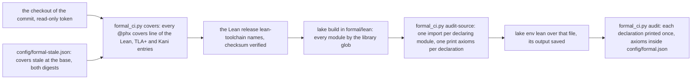

# Formal CI: from the checkout to four readings

A data-flow schematic of SPEC-614 (ADR-636). Every count was read at dev `b065fcee`; the new paths
are SPEC-614's.

## 1. The data flow

## 2. Each reading and the class of its findings

| step | reads | finding | class |
|---|---|---|---|
| covers | each covered item's span, hashed by the rule | `STALE <entry> <path>::<anchor> is sha256 <now>, the entry recorded <then>` | a moved span |
| covers | each cover's file and anchor | `UNRESOLVED <entry> <path>::<anchor> <why>` | an absent file, an anchor defined 0 or 2 times, an item that never ends, a path that is not `.rs`, `.py` or `.sh`, a malformed line |
| covers | each row of the stale list | `LISTED <entry> <path>::<anchor> <why>` | a row that reads fresh, moved again, or that no entry declares |
| covers | the population | `examined 0 covers`, exit 2 | an empty population |
| Lean install | the archive and the toolchain pin | the step fails | a checksum or version mismatch |
| build | every module | the step fails | a proof that does not build |
| audit | Lean's output | `AXIOM`, `MISSING` or `UNPLACED` | an axiom outside the list, `sorryAx`, a declaration printed other than once, a line it cannot place |
| audit-source, audit | the declarations | `examined 0 declarations`, exit 2 | an empty population |

## 3. What stays as it is

The entries, their covers, proofs, witnesses, models and harnesses; `ci.yml`, the lakefile and
`config/formal.json`; TLC and the Kani verifier, which the formal checker runs by hand (ADR-636 D3).
