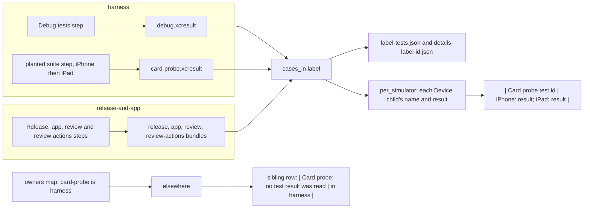

# The harness report reads the planted suite bundle (SPEC-608)

Each test step writes one result bundle; the report reads every bundle through `cases_in`, writes each case's
details beside the report, and lists each case with its result on each simulator through `per_simulator`. In the
sibling job, a bundle the other job measures is named by `elsewhere`, from the owners map.

The two report bodies are one text: `harness` reads `card-probe.xcresult` and lists its cases, and
`release-and-app`, which holds no such bundle, writes the one row that names `harness`.
