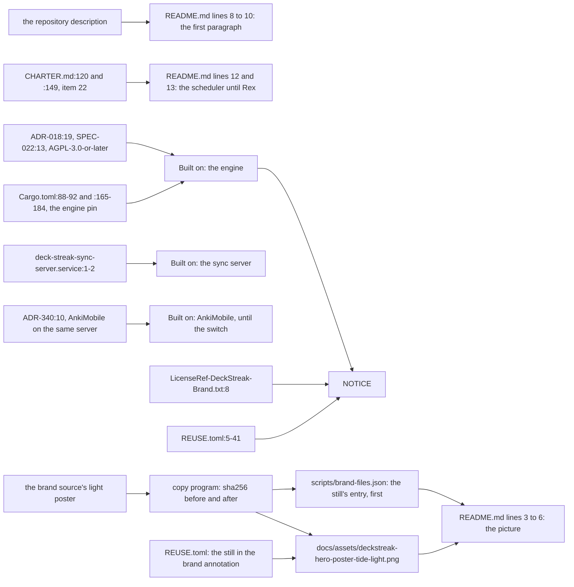
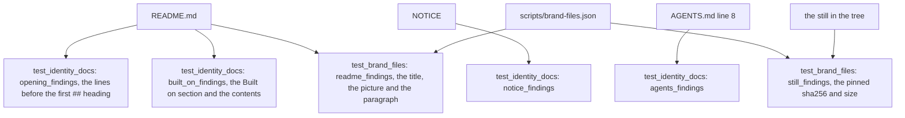

# Identity docs: the README's opening, Built on, NOTICE and the hero's still, and what checks each

Read at dev before this delivery. Decided by ADR-599; built by SPEC-580. The brand files' own flow is
`docs/schematics/brand-files.md`, whose section 5 adds the still.

## 1. Where each statement comes from and where it lands

## 2. What each check reads

## 3. Each step, its proof, its red and its row

| step | criteria | red, and where it is read | row |
|---|---|---|---|
| the opening names no barred word and quotes the description | A1, A2 | A2 red at the stub commit (planted words, each in turn); A1 red at the helper commit on dev's opening | S58004 (the description's last line) |
| the Built on section holds its five items and the trademark line | A3, A4, A5 | A4 and A5 red at the stub commit; A3 red at the helper commit (no section at dev) | S58005 (an item's lead), S58006 (the trademark line) |
| NOTICE holds its items | A6, A7 | A7 red at the stub commit; A6 red at the helper commit (no NOTICE at dev) | S58007 (the engine's licence line) |
| AGENTS.md line 8 is the identity line | A8 | red at the helper commit on dev's line 8 | S58008 (line 8) |
| the control | A9 | not red: green at every commit, so each planted red is its refusal's | none |
| the README's hero is the picture with the listed still and gif | A10, A12 | A10 red from the stub commit on (dev's image line); A12 red at the stub commit, whose helper refuses the bare image for another reason | S58001 (the still's path), S58002 (the media query), S57904 re-anchored (the gif's path) |
| the still is the brand source's poster | A11, A13 | A13 red at the stub commit; A11 red at the helper commit (no still at dev) | S58003 (the still's pinned sha256 in the list) |

Every test runs locally over a fixture tree it writes; the tree criteria read the checkout.

## 4. What stays as it is

The two owner rulings that state ANK-01, SPEC-334's existing lines, every web, Swift and Rust file, the README's
install, usage and deploy lines, `AGENTS.md` line 9 onward, every step of `docs/OWNER-SETUP.md`,
every earlier line of `docs/PRD.md`, and every brand file other than the still.
SPEC-334 gains only an appended section 11 that names the owner's signed identity ruling.
