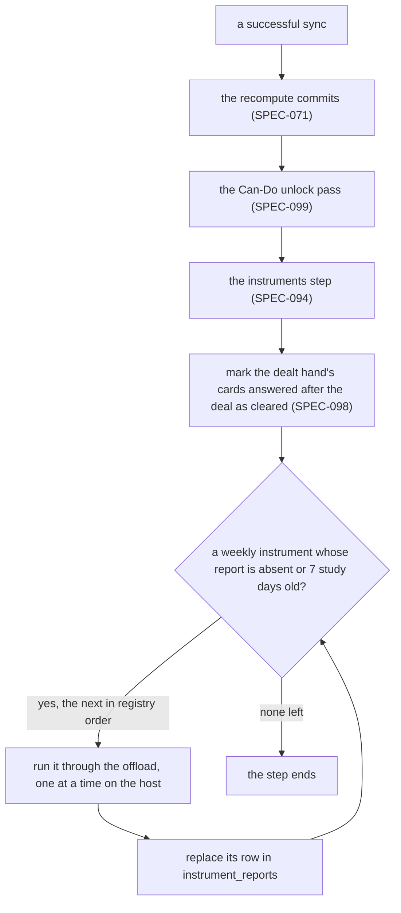
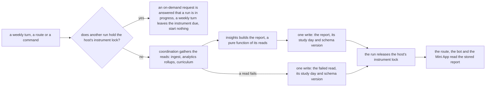
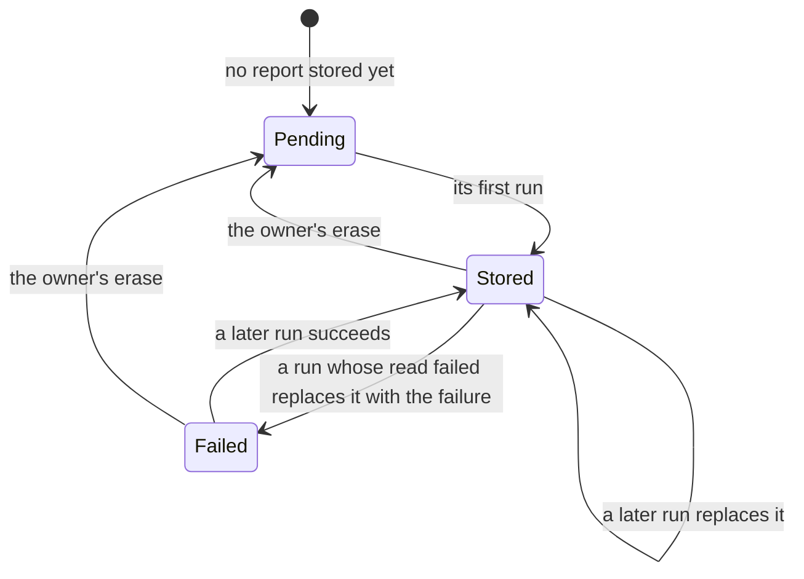
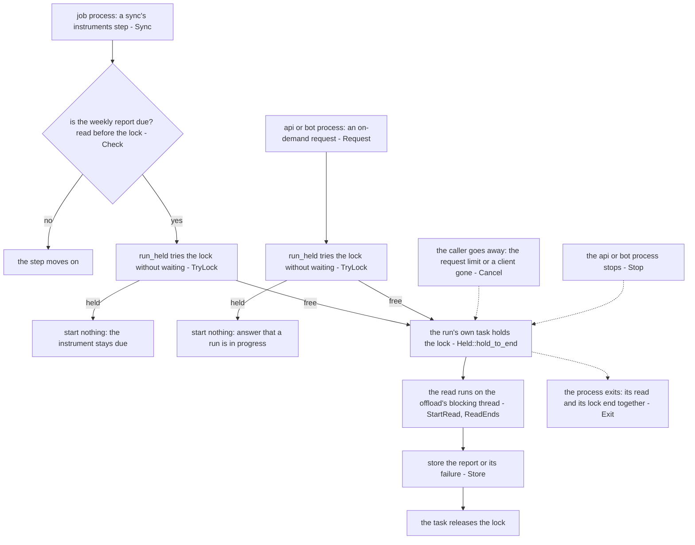
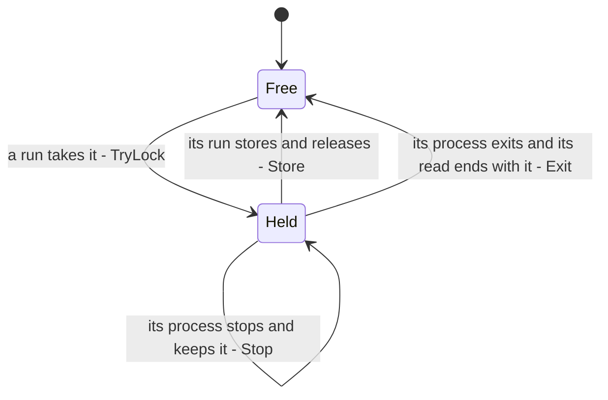

# Schematic: the insights instruments run on one frame

Kind: data flow and state machine. Read at DeckStreak `dev` dd98601 (`crates/insights/src/` holds
only `lib.rs`; `crates/coordination/src/sync_cycle.rs`) and at the predecessor's `27ee2bc`
(`pipeline_layers/read_api.py:ReadApiLayer`, `bot.py:CommandBot`, each instrument's
`build_*_report`). Decided by ADR-094 (the frame), ADR-095 (the reads keep the scope) and ADR-096
(the owner's note conventions). Added by SPEC-094; SPEC-095 to SPEC-098 register their instruments
on it. It extends `docs/schematics/data-flow.md` (the insights box) and
`docs/schematics/sync-cycle-and-change-gate.md` (what runs after a recompute), and changes neither.

## After a sync

The registry order puts the Docket after the Echo Test, the Price of a Day Off and Bench II, so it
folds their reports of the same run (SPEC-095). The cleared marks read only the sync's own study
events. A failure of one instrument is stored as its report's failed read and never stops the next.

## One instrument run

## One instrument's report

A registry row marked inert never runs and never shows. The instruments' reads are ingest's
(ADR-095): every read keeps SPEC-023's scope, a read of answers keeps its window's floor, and a set
of ids ever reviewed or a lag reads the whole scoped log. The weekly report (#130) reads the stored
reports through the one router; W4 sends none.

## The instrument lock across the three roles

Kind: data flow and state machine. Read at DeckStreak `dev` `36c4783a`. Decided by ADR-487 and
held by SPEC-470; it amends nothing above. The job, api and bot processes share one lock file,
`instruments.lock` under their one state directory, and each run reaches it through
`Instruments::run_held` (`crates/coordination/src/instruments.rs:332-368` at `36c4783a`). Each
step's label names the action of the model `formal/tla/OneInstrumentReader/` that abstracts it.

A dotted edge is an event that reaches a running run. With ADR-487's cure, a caller that goes away
leaves the task to run its read to the end, store and release (SPEC-470 A1, A2, A4), and a stopping
process keeps the lock until it exits (A3, A6); a panic in the work releases the lock and reaches
the caller (A5). At `36c4783a` both events dropped the lock while the read ran on, which the
witness `the-reader-keeps-the-lock-after-its-caller-goes` reports.

| step | code at `36c4783a` | model action | the lock's holder after it |
|---|---|---|---|
| the due read, before the lock | `instruments.rs:293-298` | `Check` | unchanged |
| the acquire, exclusive and without waiting | `instruments.rs:337`, `crates/ingest/src/lock.rs:53-70` | `TryLock` | the run, or unchanged when refused |
| a refused weekly turn | `instruments.rs:305-308` | `TryLock` refused | unchanged; the instrument stays due |
| a refused on-demand request | `crates/api/src/insights_routes.rs:113` | `TryLock` refused | unchanged; answered in progress |
| the read | `crates/ingest/src/reader.rs:381-414` | `StartRead`, `ReadEnds` | the run |
| the store and the release | `instruments.rs:350-353` | `Store` | none |
| a caller gone | `crates/api/src/router.rs:320-323` | `Cancel` | the run (cure); none at `36c4783a` |
| a stop | `crates/daemon/src/main.rs:111-112` | `Stop` | the run (cure); none at `36c4783a` |
| the process's exit | the operating system closes the lock file | `Exit` | none |

The model's invariant `AtMostOneReader` says at most one instrument run holds the lock and reads at
any time; its liveness `ADueWeeklyRunRunsOnceTheLockIsFree` says a due weekly run eventually runs
once the lock is free. Four witnesses each break one: `one-reader-needs-the-exclusive-acquire`
(no exclusive acquire), `the-reader-keeps-the-lock-after-its-caller-goes` (the code at
`36c4783a`), `the-reader-keeps-the-lock-until-its-process-exits` (the task alone) and
`a-due-weekly-run-runs-once-the-lock-is-free` (the guard alone). The due read before the lock lets
a weekly run start after an on-demand run stored, a redundant run after the other one and never
beside it. The collection lock's same release inside `with_copy` is not this section's (#957).
