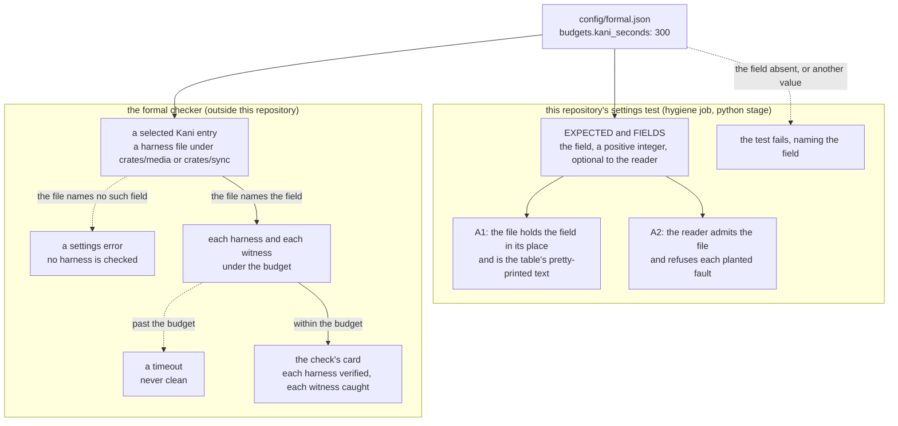

# The Kani run budget: from the settings file to a Kani run

- **Kind:** data flow.
- **Read at:** the development branch's commit `e08ba4a`; every `path:line` below is at that commit,
  before this change adds the field.
- **Decided by:** ADR-626 (SPEC-605). It amends SPEC-295 R1 and ADR-295 by one field; no byte of
  either file changes.

## The flow

The settings file is the one place the Kani run budget is stated. Two readers take it: this
repository's settings test, which holds the file to its own table and reads the field the way the
formal checker reads it; and the formal checker, outside this repository, which runs each harness and
each witness of a selected Kani entry under the budget. Solid edges are the agree path; dotted edges
are the ways a reading fails, each ending where it is observed.

## Agree and disagree

| case | the settings test | the formal checker | observed by |
|---|---|---|---|
| the file and the table both state the field with a value of 300 | admits the file; A1 and A2 green | checks each harness and witness of a selected Kani entry under it | A1 and A2 green; the local check's card |
| the table states the field and the file does not | A1 fails by its assertion naming `('budgets', 'kani_seconds')`; the reader admits the file, the field being optional | refuses a selected Kani entry as a settings error | A1, red at the red commit of SPEC-605 |
| the file states another value | A1 fails on the value | reads the other value as the budget | A1; row S60500 |
| the table states another value | A1 fails on the value | not a reader of the table | A1; row S60501 |
| the reader's field table forgets the field | the reader refuses the file as naming an unknown field | not a reader of the table | A2; row S60502 |
| a Kani run past the budget | not a reader of runs | a timeout, never clean | the local check's card |

## Where each step lives

| step | where, at `e08ba4a` |
|---|---|
| the run budgets the field joins | `config/formal.json:3-21` (`lean_seconds` at `:5`, `entry_seconds` at `:6`); the field goes between them |
| the test's expected table and field table | `scripts/tests/test_formal_config.py:24-49` (`budgets` at `:26-44`) and `:52-63` |
| the test's reader | `scripts/tests/test_formal_config.py:152-191` (`read`) |
| A1 | `scripts/tests/test_formal_config.py:498-508`; the two fields it admits as absent at `:505` |
| A2 | `scripts/tests/test_formal_config.py:549-573` |
| the job that runs the test | `.github/workflows/ci.yml:298` (`hygiene`), its step at `:351`; `scripts/check.sh:179-196` (the `python` stage, discovery at `:186`) |
| the Kani harnesses | `crates/media/src/kani_proofs.rs:29`, `:59`, `:95`, `:126`; `crates/sync/src/kani_proofs.rs:44`, `:82`, `:95`, `:107` |
| the rows on the field | `scripts/mutation-rows.d/S60500-S60599.json`, added by SPEC-605 |
| the row on the settings file before this change | `S29530` in `scripts/mutation-rows.d/S29500-S29599.json` |
