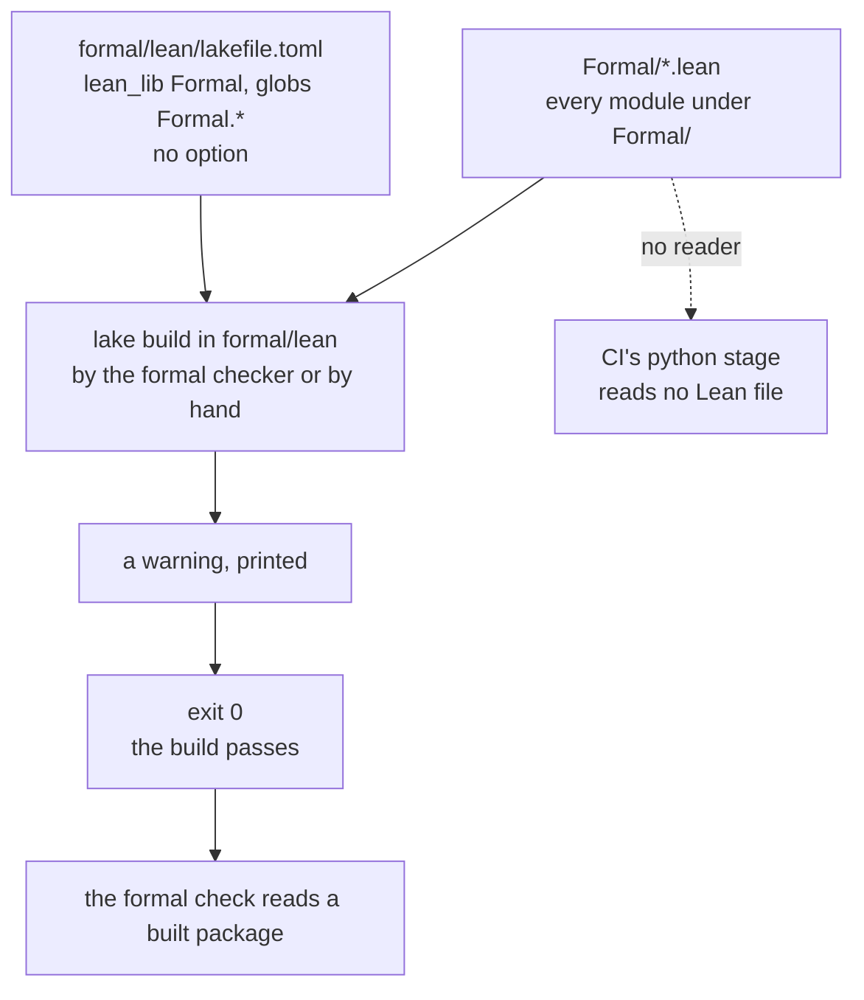
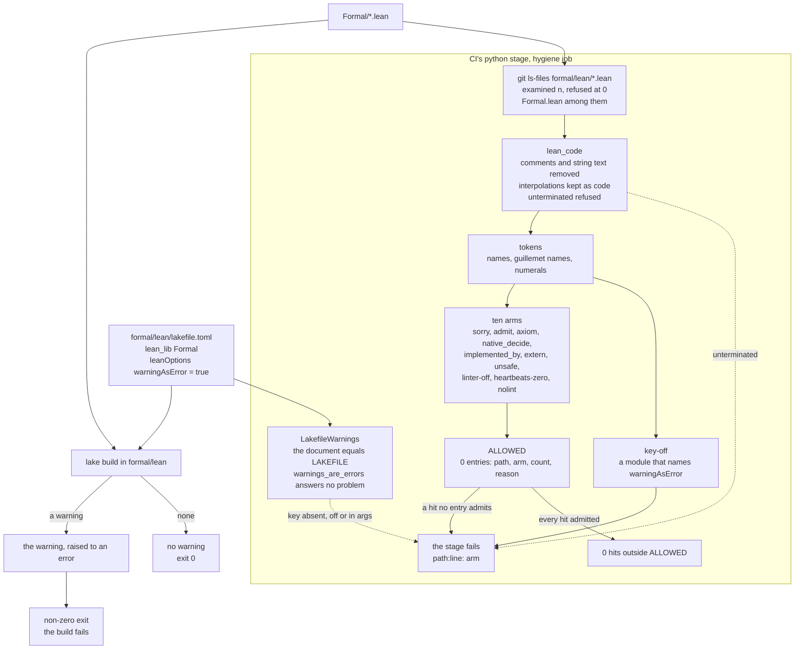
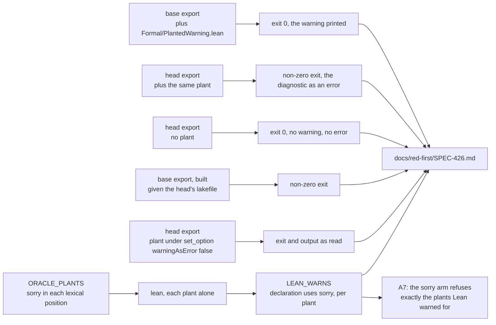

# The Lean build's warnings are errors, and a guard refuses the escape hatches

- **Kind:** data flow, before and after.
- **Read at:** the development branch's commit `ac7ebd75`; every `path:line` below is at that
  commit.
- **Decided by:** ADR-440 (SPEC-426). It amends nothing: the settings flow keeps its own schematic,
  `docs/schematics/formal-check-settings.md`.

## Before: a warning passes the build

`formal/lean/lakefile.toml:1-8` declares one library, `Formal`, built by the glob `Formal.*` as the
package's one default target, with no option set. Two builders run `lake build` in `formal/lean`:
the formal checker, outside this repository, whose Lean budget `config/formal.json` names
(`budgets.lean_seconds`), and a person by hand. CI runs neither: no file names `lake build`, and
no workflow names Lean. A warning is printed and the exit code stays 0.

## After: a warning fails the build, and the python stage reads every Lean file

The library's own `leanOptions` sets `warningAsError = true`, so every warning a module of the
library raises is an error and the build exits non-zero. `scripts/tests/test_formal_config.py`'s
class `LakefileWarnings` pins the lakefile, and `scripts/tests/test_lean_escape_hatches.py` reads
every tracked `.lean` file under `formal/lean`, both in the python stage that
`scripts/check.sh:185-186` runs in the `hygiene` job (`.github/workflows/ci.yml:298` and `:351`).

## The red-first proof and the oracle, read locally

CI builds no Lean, so the build's rule is read where Lean runs, with the Lean
`formal/lean/lean-toolchain` names, in exports of each commit's `formal/lean` outside the work
tree. The matcher's lexing is held to Lean's own elaboration of a table of planted files, whose
verdicts the guard module records as data.

## Where each step lives

| step | where | read at `ac7ebd75` |
|---|---|---|
| the library and its glob | `formal/lean/lakefile.toml:6-8` | one `[[lean_lib]]`, `name = "Formal"`, `globs = ["Formal.*"]` |
| the default target | `formal/lean/lakefile.toml:2` | `defaultTargets = ["Formal"]` |
| the key | `formal/lean/lakefile.toml`, after line 8 | added by SPEC-426 R1 |
| the package's dependencies | `formal/lean/lake-manifest.json:3` | `"packages": []` |
| the pinned Lean | `formal/lean/lean-toolchain:1` | the one line the toolchain reads |
| the population | `git ls-files` under `formal/lean/` | 28 `.lean` files, 6164 lines |
| the stage | `scripts/check.sh:185-186` | `python3 -m unittest discover -s "$suite" -p 'test_*.py'` |
| the job | `.github/workflows/ci.yml:298`, `:351` | `hygiene`, `bash scripts/check.sh python scrub secrets` |
| the presence harness's population | `scripts/tests/test_formal_config_presence.py:177` | `FormalConfig`'s tests alone |

The formal checker's Lean check builds the package too. Its readings at the base and the head are
recorded in `docs/red-first/SPEC-426.md`, beside the build's own exit codes and diagnostic lines.
