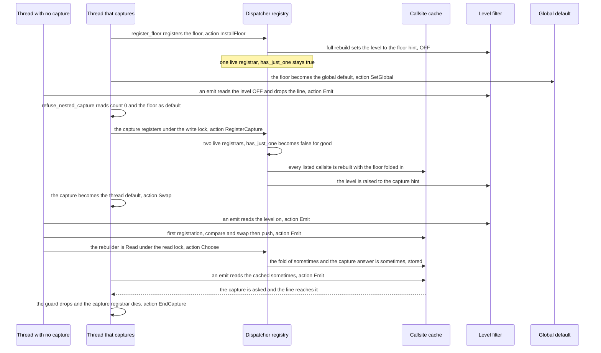
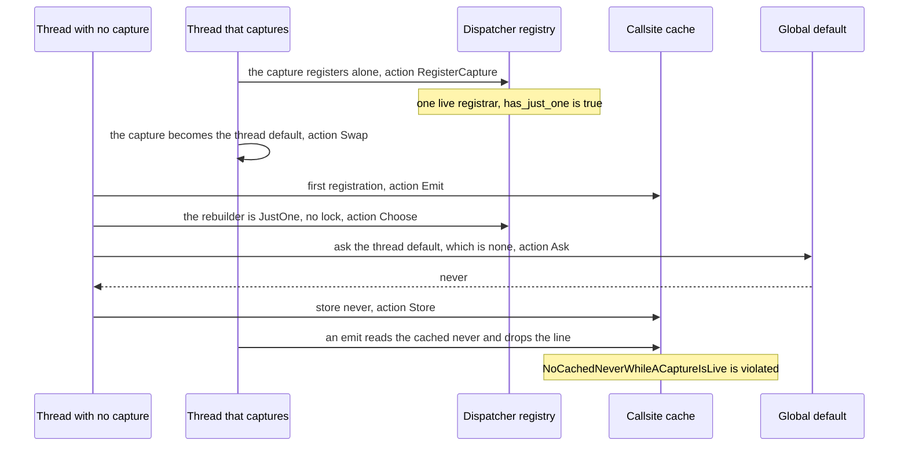
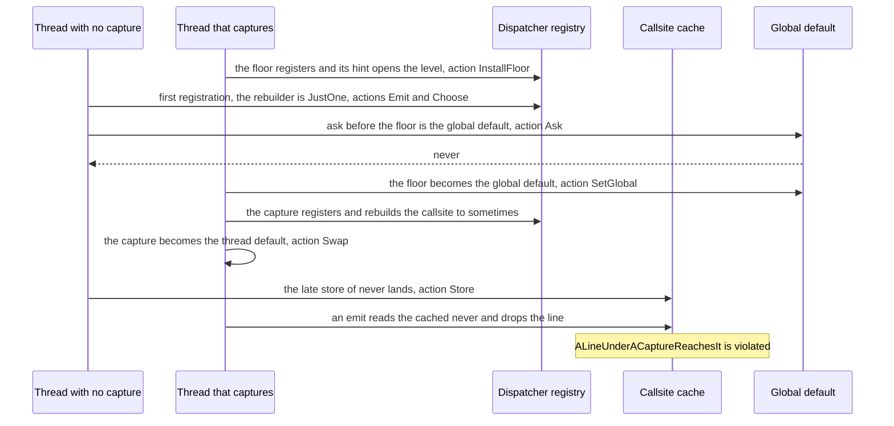

# The test log capture's floor and the callsite interest cache

A sequence schematic of two threads in one test binary, one that holds no capture and one that
installs a capture, through a callsite's first registration, its cached interest and the rebuild,
the floor's install, the capture's dispatcher registration and default swap, to each line reaching
its capture or not. Every `path:line` was read at dev `36c4783a`; `tracing-core` lines are into the
version `Cargo.lock` locks, by its own `src/` file. SPEC-475 and ADR-492 decide it, and
`formal/tla/LogCaptureFloor/` models it.

## 1. The code at dev: the line reaches the capture

## 2. Witness one: the floor taken away

## 3. Witness two: a floor that hints a level

Witness three, a rebuild or a direct registration outside the helper, opens the level or skips it
before the floor exists, and its first ask is made with no global default:
`NoInterestIsAskedBeforeTheFloor` is violated at that ask.

## 4. Each step, its code and its action

| step | code | model action |
|---|---|---|
| the level gate before the callsite | `crates/kernel/tests/log_capture_class.rs:207-216` (the tree's emulation of a macro); `tracing-core` `src/metadata.rs:245` | `Emit(t)` |
| a first registration's compare and swap and push | `src/callsite.rs:310-318`, `:437-463` | `Emit(t)` |
| a registering callsite read by another thread | `src/callsite.rs:326-333` | `Emit(t)` |
| the cached read | `src/callsite.rs:347-354` | `Emit(t)` |
| the rebuilder's choice | `src/callsite.rs:319`, `:544-549` | `Choose(t)` |
| the locked fold and store | `src/callsite.rs:490-507`, `src/subscriber.rs:658-664` | `Choose(t)` |
| the lock-free ask of the thread default | `src/callsite.rs:564-566`, `src/dispatcher.rs:379-397`, `:446-449` | `Ask(t)` |
| the store and the registered mark | `src/callsite.rs:506`, `:358-365`, `:320` | `Store(t)` |
| the emission's load of the cache | `src/callsite.rs:337-341` | `Load(t)` |
| the floor's registration | `tools/log-capture/capture.rs:82`, `src/callsite.rs:484-488`, `:551-557`, `:407-422` | `InstallFloor` |
| the floor as the global default | `tools/log-capture/capture.rs:82`, `src/dispatcher.rs:299-331` | `SetGlobal` |
| the refusal, then the capture's registration | `tools/log-capture/capture.rs:117-128`, `:158`, `:161`, `:170-171` | `RegisterCapture` |
| the default swap | `src/dispatcher.rs:276-281`, `:841-852` | `Swap` |
| the capture's end | `tools/log-capture/capture.rs:133-150`, `src/dispatcher.rs:889-899`, `:805-808` | `EndCapture` |
| a rebuild outside the helper | `src/callsite.rs:222-224` | `Rebuild(t)`, witness three only |
| a registration that skips the level gate | `src/callsite.rs:236-253` | `DirectRegister(t)`, witness three only |

## 5. Tests, witnesses and covers

- **Tests.** `log_capture_class`'s four scenarios (`crates/kernel/tests/log_capture_class.rs:260`)
  drive chosen orders of section 1 in child processes; the model explores every order of the two
  threads over one callsite.
- **Witnesses.** Section 2 is `witness/no-cached-never-while-a-capture-is-live.cfg`
  (`Floor = FALSE`); section 3 is `witness/a-line-under-a-capture-reaches-it.cfg`
  (`FloorHintsOff = FALSE`); witness three is `witness/no-interest-is-asked-before-the-floor.cfg`
  (`CensusHolds = FALSE`).
- **Covers.** `register_floor`, `with_capture`, `hold_capture`, `refuse_nested_capture`,
  `register_callsite` and `max_level_hint` in `tools/log-capture/capture.rs`.
- **What section 1 shows.** With the floor hinting `OFF`, no thread passes the level gate until the
  capture's registration, which also makes `has_just_one` false, so the lock-free ask of sections 2
  and 3 is not reached while the floor is installed as the code installs it.
