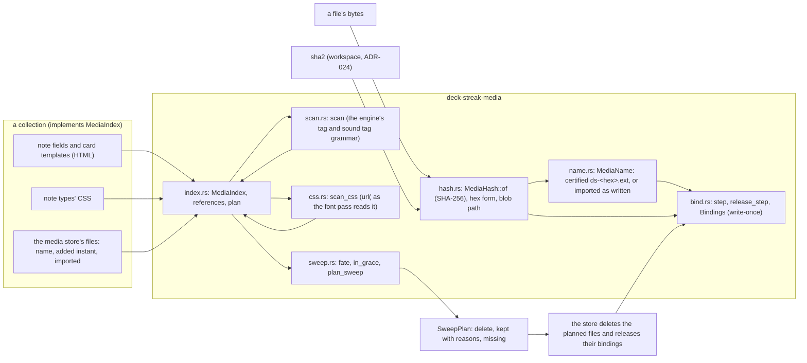
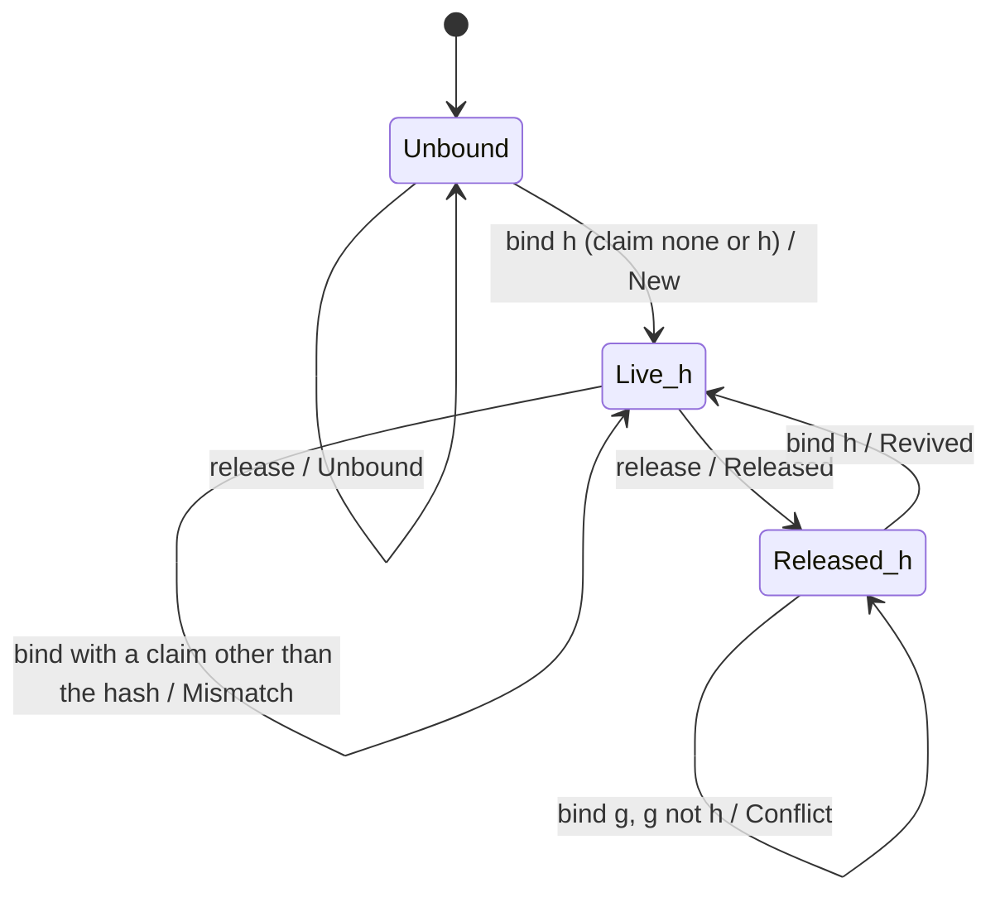
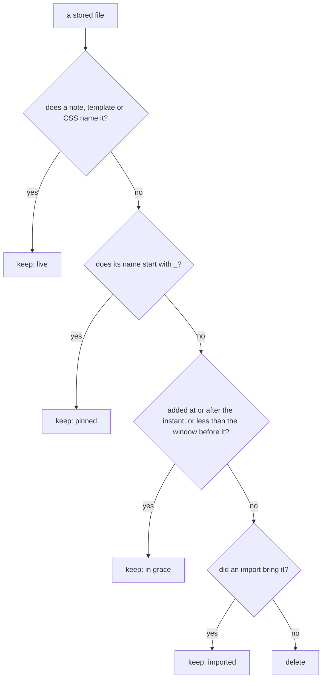

# Schematic: a media file's hash, its names and their bindings, the names a note writes, and the sweep

Kinds: component, and the binding state machine. Read at the delivery's base `554a223e`, and at the pinned engine
`a078820f` for the grammar it ports (`rslib/src/text.rs`, `rslib/src/media/check.rs`). Decided by ADR-531; built by
SPEC-513.

## Component

The media core is one crate with no workspace edge. A collection hands it texts and stored files through
`MediaIndex`; it hands back names, bindings and a sweep plan. It reads no file, clock or environment.

## The binding state machine

One name's slot, under `step` (a bind of hash `h`, with the claim of a certified name) and `release_step`. A refusal
leaves the slot as it was. A slot never returns to unbound, and its hash never changes.

## What a sweep keeps

Each stored file is asked in this order, and the first answer that holds is its fate.

