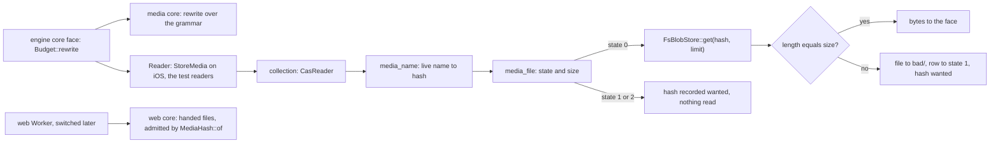
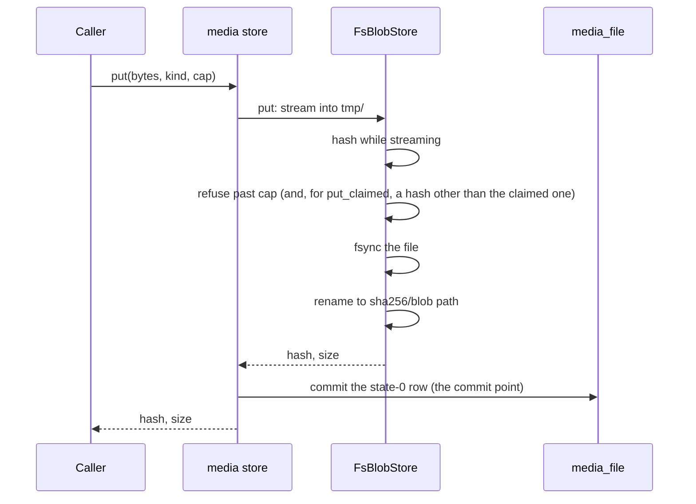

# Media store (SPEC-601, ADR-621)

## Data flow: a face reads a media file

## Sequence: a put

## Open-time pass

`tmp/` is emptied, and every hash path under `sha256/` without a state-0 row is deleted; no file is adopted.
