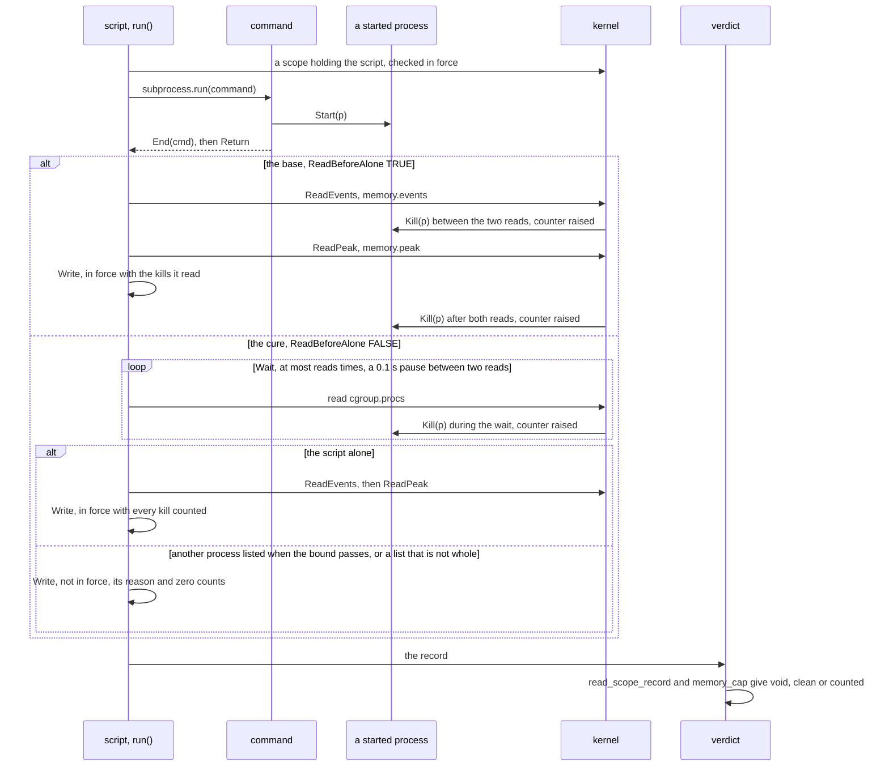
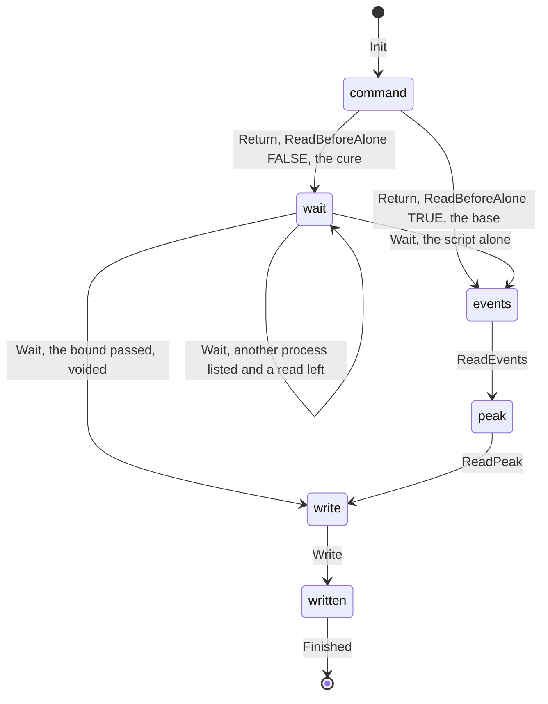

# The memory scope's reads after the command (SPEC-467, ADR-484)

Kinds: a sequence and a state machine. Every `path:line` below was read at dev
`36c4783a29c44d2ffafc987803ccb1742a2c2cfc`; the cure's code is named by item, since it has no line at that commit. The
model is `formal/tla/LateKillCounted`, and its action names label the edges. Issue #469; SPEC-196 states the scope and
its record.

## 1. The sequence, the base and the cure

The script's own process is in the scope beside the command's processes, so the scope is never empty while the script
reads. On the base, the counts are read as soon as the command exits; with the cure, they are read only once the
scope's process list holds the script alone.

## 2. The script's place, `pc`

Each edge is the model action that takes it. `Kill(v)` and the command's own `Start` and `End` are enabled in every
place and move no place; a kill of the script's own process leaves its record `running`, which the verdict voids.

## 3. Each step, its code, its action, its test and its witness

The witnesses are the main configuration with `ReadBeforeAlone = TRUE`: `EveryKillIsCountedOrTheRecordIsVoid`,
`NoKillIsReadAsACleanRun`, `AKillBetweenTheTwoReadsIsCountedOrTheRecordIsVoid` and
`AKillAfterBothReadsIsCountedOrTheRecordIsVoid`, each in `witness/<its name>.cfg`.

| step | code item | model action | test | witness |
|---|---|---|---|---|
| the scope is asked for, holding the script's own process | `scope_call` (`scripts/memory_scope.py:75-78`, called at `:276-282`) | `Init` (`wrapper` live, `pc` at `command`) | SPEC-196's tests, unchanged | none |
| the checks before the command, and their refusal | `check_in_force` (`:201-235`), `refuse` (`:238-252`) | abstracted: a refusal before the command is a void path | SPEC-196's tests, unchanged | none |
| the command runs and may start processes | `run` (`:301`) | `Start(p)`, `End(q)` | the plants of A1 to A6 | every witness starts one |
| the command exits and `subprocess.run` returns | `run` (`:301`) | `End(cmd)`, then `Return` | every criterion | every witness, by `Return` straight to `ReadEvents` |
| the cure: the wait reads the process list | `alone_after`, called by `run` after the command | `Wait` | A3, A4 | none: the switch is on in each |
| the cure: the list is whole, and how many others it holds | `others_after` | abstracted: a list that is not whole is a void path | A5, and A6's alone list | none |
| the cure: the bound passes with another process listed | `alone_after` | `Wait`, with `voided` set | A1, A2, A4 | none |
| the kill counters are read | `counts_after` through `events_of` (`:169`, the file read at `:142`) | `ReadEvents` | A3, A6 | the between and after windows open here |
| the peak is read | `counts_after` through `peak_of` (`:175`, the file read at `:156`) | `ReadPeak` | A3, A6 | `AKillBetweenTheTwoReadsIsCountedOrTheRecordIsVoid` |
| the record is written, once | `run` (`:304-313`) | `Write` | A1 to A6 | `AKillAfterBothReadsIsCountedOrTheRecordIsVoid` |
| the kernel stops a process at the cap and raises `oom_kill` | the kernel, not the tree | `Kill(v)` | A1 between the reads, A2 after both, A3 during the wait | `EveryKillIsCountedOrTheRecordIsVoid`, `NoKillIsReadAsACleanRun` |
| the verdict reads the record | `read_scope_record` (`scripts/mutation-verdict.py:1866-1885`), `memory_cap` (`:1930-1969`) | `Verdict` | SPEC-196's verdict tests, unchanged | every property reads it |
| the script has ended and so has every process of the command | none | `Finished` | none | none |

## 4. What the model leaves out, and why each is safe

- The refusals before the command, the process-list arms that are not whole, and `counts_after`'s own voids each write
  a record that is not in force, so the verdict reads it void; each is a void path, never a clean run.
- `oom` moves with `oom_kill`: the verdict reads the two together, and SPEC-196 states the case of one without the other.
- No process joins the scope from outside the command's tree; ADR-484 names that as what would make it wrong.
