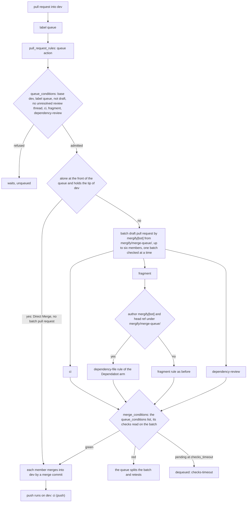

# Schematic: the merge queue into dev (SPEC-604, ADR-625)

Kind: data flow. It draws the path a pull request into dev takes from its label to its merge
commit, as `.mergify.yml` and `.github/workflows/changelog.yml` define it once SPEC-604 lands.

The `fragment` check passes a batch whose members each add a fragment by its existing rule; the arm
above matters only for a batch that adds none, which is a batch of dependency updates alone.
