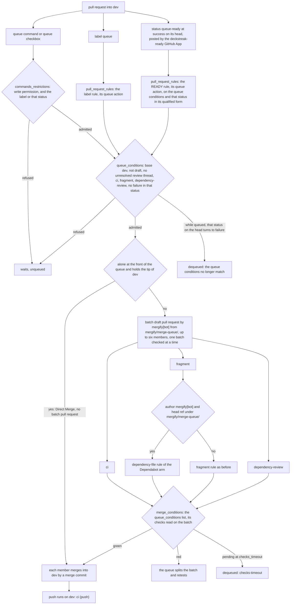

# Schematic: the merge queue into dev (SPEC-604, ADR-625, ADR-689)

Kind: data flow. It draws the paths a pull request into dev takes to its merge commit, by its
label or by the READY status the `deckstreak-ready` GitHub App posts on its head, as `.mergify.yml`
and `.github/workflows/changelog.yml` define them.

The `fragment` check passes a batch whose members each add a fragment by its existing rule; the arm
above matters only for a batch that adds none, which is a batch of dependency updates alone.

The two pull request rules decide entry, so the queue conditions name neither the label nor the
status; they refuse a pull request whose status from that App reads `failure`, whichever way it came.
The App never posts on a batch pull request, so the merge conditions, which repeat the queue
conditions, read no failure there.
