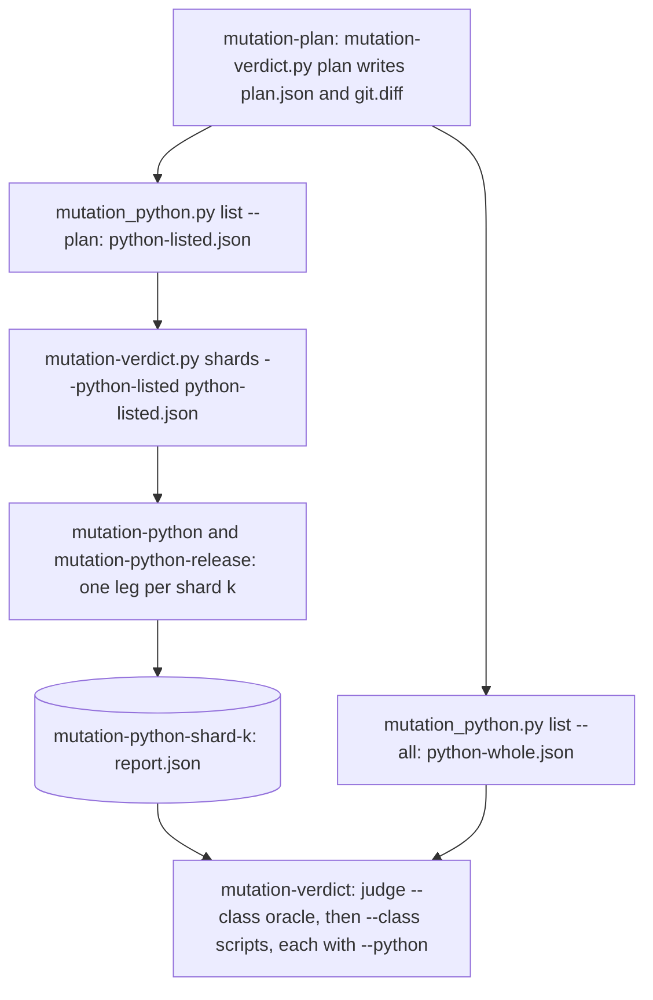
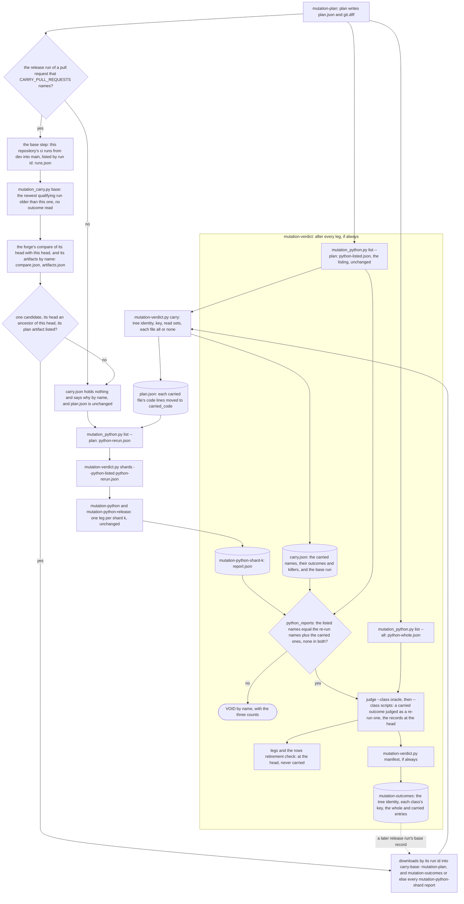
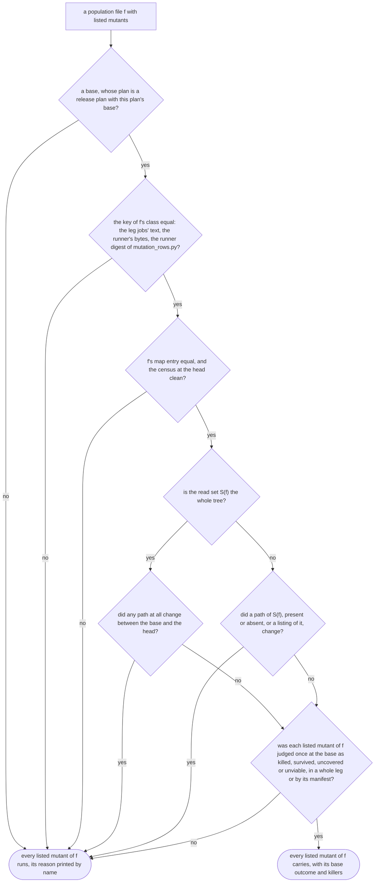

# Schematic: the release run carries a Python outcome from one base run, and deals only the rest

Kind: data flow (the release run's Python path through `mutation-plan`, the Python legs and
`mutation-verdict`, before and after the carry), with one population file's carry decision drawn
as a flowchart. Read at DeckStreak `dev` `75d555c4` (`.github/workflows/ci.yml`,
`scripts/mutation-verdict.py`, `scripts/mutation_python.py`, `scripts/mutation_rows.py`). Decided
by ADR-511; built by SPEC-493.

This ADDS to `docs/schematics/mutation-testing-python.md` and redraws none of it: the Python legs,
the equivalence records and the verdict's Python class are drawn there, and here each appears as
one node. Rust, rows and web run as that schematic and `docs/schematics/mutation-testing.md` draw
them, and carry nothing.

## 1. Before: every listed Python mutant runs

At `75d555c4` the plan step (`ci.yml:399-409`) writes `plan.json` and `git.diff`, the runner lists
the diff's Python mutants and the whole population's (`ci.yml:435-438`), and `shards`
(`ci.yml:439-441`) deals every listed mutant into legs. The plan's artifact keeps the whole
`mutation/` directory (`ci.yml:449-455`).

## 2. After: listing, carry, deal and judge

The listing steps, `shards`, `planned_leg` (`scripts/mutation_python.py:1252`) and the runner are
unchanged. `carry` runs on every event and writes `carry.json`; only on an admitted release run does
it find a base and carry anything. The union rule lives in `python_reports`
(`scripts/mutation-verdict.py:1970`), which `judge_python` (`:2139`) calls for each Python class.

## 3. One population file's carry

All of a file's listed mutants carry, or none does (SPEC-493 R8). Every refusal prints the
file's reason by name, and the file runs whole.

## 4. What crosses each step

| from | to | what | shape |
|---|---|---|---|
| the forge's runs listing | `mutation_carry.py base` | this repository's `ci` runs for pull requests from `dev` into `main` | `runs.json` |
| the forge's compare and artifacts listing | `mutation_carry.py base` | whether the candidate's head is an ancestor of this head, and which artifacts it kept | `compare.json`, `artifacts.json` |
| the base run | `carry` | its plan, its diff and its listing | `carry-base/mutation-plan/`: `plan.json`, `git.diff`, `python-listed.json` |
| the base run | `carry` | its manifest, or else its legs' reports | `carry-base/mutation-outcomes/mutation-outcomes.json`, or `carry-base/legs/mutation-python-shard-k/report.json` |
| `carry` | the re-run listing | the plan with each carried file's `code` lines in `carried_code` | `plan.json` |
| `carry` | `mutation-verdict` | the carried names, outcomes and killers, and the base's run id | `carry.json`, schema `deckstreak.mutation-carry.v1`, in the `mutation-plan` artifact |
| the runner | `shards` | the re-run set | `python-rerun.json` |
| `mutation-plan` | `mutation-verdict` | the listing the union rule holds the legs and the carry to | `python-listed.json` |
| the Python legs | `mutation-verdict` | one report per leg | `mutation-python-shard-k/report.json` |
| `mutation-verdict` | a later release run | this run's tree identity, keys and judged entries | `mutation-outcomes`, schema `deckstreak.mutation-outcomes.v1` |

## 5. What is never carried

- Rust, rows and web outcomes: they run as before.
- A `timeout` or `void` outcome, and any mutant of a partial or VOID leg.
- Any outcome on a run that is not admitted.
- The equivalence records, the rows retirement check and `legs`: each is evaluated at the head.

## 6. How `ci` reads the release run's jobs (SPEC-500, ADR-518)

Every step above runs on the release run as drawn, and its results reach the run as before: the legs' reports, the
verdict's judgement and `mutation-outcomes`, which `mutation-verdict` uploads whatever the legs returned, so a later
release run can carry from this one. What changes is `ci`'s reading on that run alone, drawn in
`docs/schematics/mutation-testing.md` section 13: `base-is-dev` names the release run by `release_run`'s predicate,
and `ci` prints `mutation-plan`'s, the Python legs' and `mutation-verdict`'s results, with the other mutation jobs',
as advisory lines and admits each by value. A carry refused by name, a VOID leg or a survivor still reads red in its
own job and its report on the release run; on every other run a red mutation job still fails `ci`.
