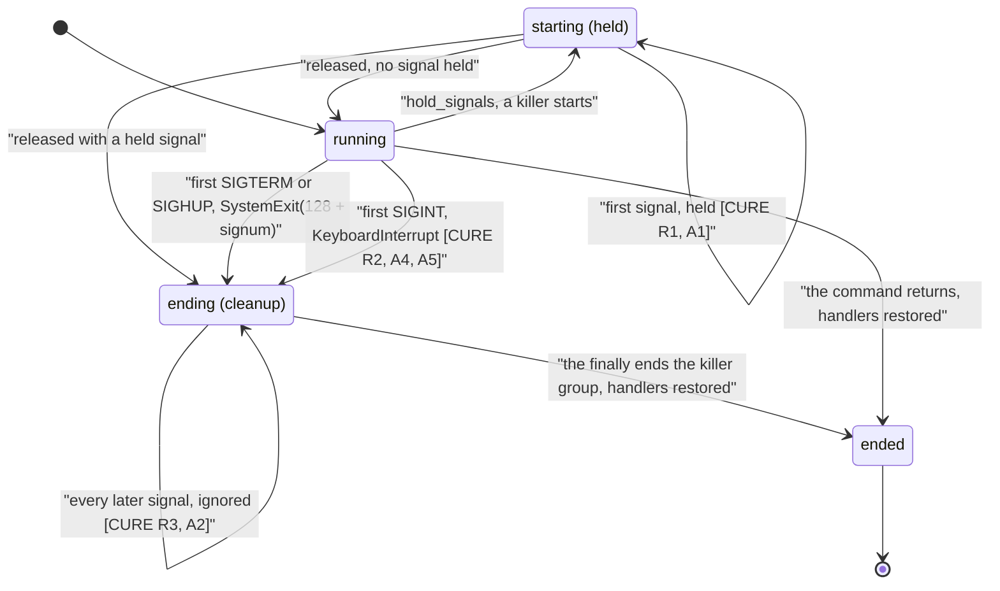

# Schematic: the row runner's interrupt, from SIGINT to the killer group's end (SPEC-647, ADR-670)

Kinds: a state diagram (section 1) and a table (section 2).

Every `path:line` below was read at `bd953ba7` in `scripts/mutation_rows.py` unless it names
another file.

## 1. One handler, three signals

At the base SIGINT reached `default_int_handler`, outside the hold and the latch: during the
killer's start (`:1007`, before the `try` at `:1022`) or during the cleanup (`:1029-1031`, before
`kill_group`) it raised `KeyboardInterrupt` past the group kill, and a SIGTERM after it, or it after
a SIGTERM, ended the cleanup early. After the cure the run's one handler takes it, holds it in
`starting`, latches it in `ending`, and still ends the run as the interpreter's own interrupt.

## 2. Where each step lives

| step | at the base | after |
|---|---|---|
| the installation | `ending_on_signals` (`:1505`, `:1518-1524`): SIGTERM, and SIGHUP unless ignored | the same, and SIGINT unless ignored |
| the first interrupt's ending | `default_int_handler`, the interpreter's own | `RunSignals.handle` (`:1475`), raising `KeyboardInterrupt` |
| a held interrupt | none: it was never held | `released` (`:1493`), inside the `try` whose `finally` ends the group |
| an interrupt held at a failed start | none | after the `yield` (`:1525-1527`) |
| the restore | two handlers, SIGTERM and SIGHUP (`:1528-1530`) | three, SIGINT with them |
| the tests | A21's group test (`scripts/tests/test_mutation_rows_group.py:291`) | the six of SPEC-647 in `scripts/tests/test_mutation_rows.py` |
