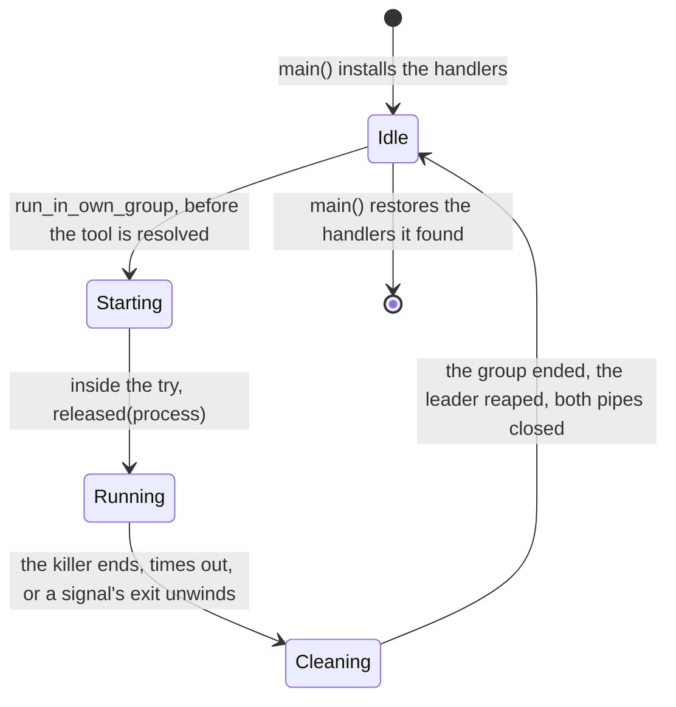
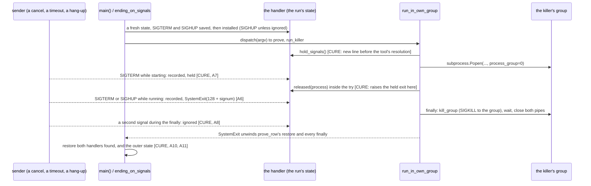
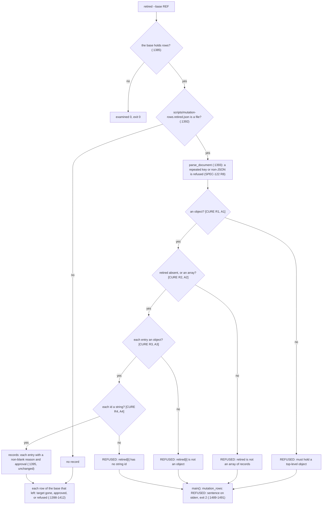

# Schematic: the row runner's signals, from `main()` to every return, and the retired list's read

Every `path:line` below was read at `36c4783a`, the base; the cure's names are SPEC-465's. Kinds: a
state machine (section 1), a sequence (section 2) and a data flow (section 3). The schematic that
owns the runner's whole job, `docs/schematics/mutation-testing.md`, is left as it stands.

## 1. The runner's phases, and what a signal does in each

The runner moves through five phases for each killer it starts. At the base only SIGTERM has a
handler (`scripts/mutation_rows.py:1427`, installed by `main()` at `:1431`).

| phase | base, first SIGTERM | base, SIGHUP | base, a second SIGTERM | cure, first SIGTERM or SIGHUP | cure, a later signal |
|---|---|---|---|---|---|
| Idle | exits 143 through every `finally` | default action: the runner ends, no cleanup | exits again mid-unwind | exits `128 + signum` through every `finally` (A6) | ignored (A8) |
| Starting (`:992` to `:1010`) | `SystemExit` outside the `try`: the group runs on | the runner ends, the group runs on | as the first | recorded and held; `released` raises it inside the `try` (A7); a failed start raises it when the command returns (A12) | ignored |
| Running (`:1010-1011`) | `SystemExit` inside the `try`; the `finally` ends the group (SPEC-025 A18) | the runner ends, the group runs on | — | exits `128 + signum`; the `finally` ends the group (A6) | ignored |
| Cleaning (`:1012-1020`) | — | the runner ends mid-cleanup | a second `SystemExit` before `kill_group` (`:1017`): the group runs on | — | ignored, so the cleanup runs to its end (A8) |
| after `main()` returns | the handler stays installed | — | — | the handlers found are back (A10); no state is left (A11) | the found handler's action |

A SIGHUP ignored when `main()` begins stays ignored in every phase (A9).

## 2. One killer's run, with the cure marked

The anchors this path keeps: S03966 (`:992-994`), S03975 (`:1004-1011`, which ends at
`stdout, stderr`, so `released` sits in the rest of that line), S02504 (`:1002`), S02505 (`:1016`),
S02507 (`:1012-1014`), S02508 (`:1020`) and S02503 (`:1030`). S02506 (`:1427`) moves to the new
SIGTERM installation.

## 3. The retired list's read, each shape's path

At the base, `E` to `H` do not exist: each wrong shape raises `AttributeError`, `TypeError` or
`KeyError` at `:1394` to `:1396` and exits 1 with a traceback, and a `retired` value of `{}` or
`""` reaches `J` as no record. The cure's boxes are one reader, `retirement_records`, the Lean
entry `lean/RetiredListShape` ports, and A14 drives every vector of that proof through `retired`.

## 4. Where each step lives

| step | at the base | after |
|---|---|---|
| the SIGTERM handler | `end_on_sigterm`, `scripts/mutation_rows.py:1420-1427` | the run's state and its handler; `ending_on_signals` |
| `main()` | `:1430-1495` | `main` wraps `dispatch`, the base body less its first line |
| the killer's start | `run_in_own_group`, `:974-1024` | the same, with `hold_signals()` and `released(process)` |
| the group kill | `kill_group`, `:1027-1030` | unchanged |
| the retired list's read | `retired`, `:1391-1396` | `retirement_records`, called after `:1393`'s `parse_document` |
| the tests | `scripts/tests/test_mutation_rows_group.py` (SPEC-025 A16 to A21) | unchanged, and SPEC-465's in `scripts/tests/test_mutation_rows.py` |
