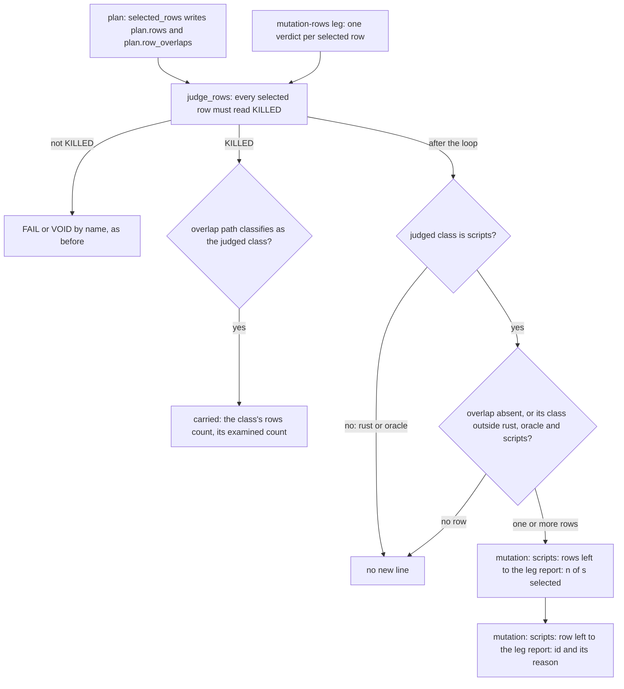

# Schematic: the rows the scripts class leaves to the leg report

Data flow of SPEC-625, decided by ADR-647: how a selected row reaches a class's examined count, and
where a KILLED row that no class credits is named instead. Every name below is a definition of
`scripts/mutation-verdict.py`: `selected_rows`, `judge_rows`, `classify`, `klass_rows` and the new
`leave_rows_to_the_leg_report`.

The left rows reach no count: the edge into `carried` is the only one that adds to a class's
examined count, and it is the one the base already had. A row's reason is `its changed line is in
<path>` when the plan records an overlap path for it, and `it covers no changed line` when it does
not.
