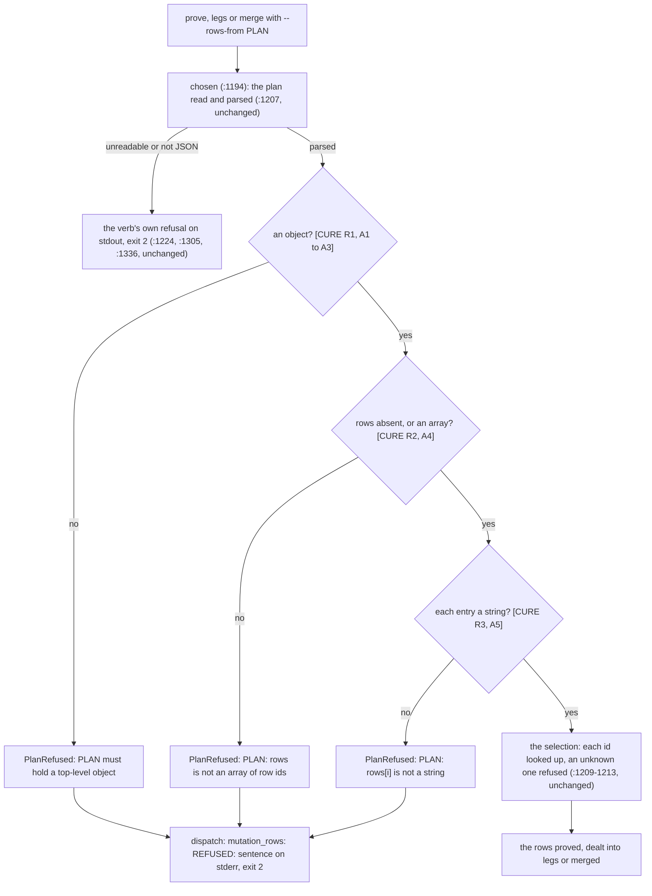

# Schematic: the --rows-from plan's read, from its text to each verb's refusal (SPEC-645, ADR-668)

Kinds: a data flow (section 1) and a table (section 2).

Every `path:line` below was read at `bd953ba7`, the base, in `scripts/mutation_rows.py` unless it
names another file; the cure's names are SPEC-645's.

## 1. The plan's read, each shape's path

At the base, `C` to `E` do not exist: `chosen` adds `plan.get("rows", [])` (`:1208`) to the ids it
gathers. A plan that is not an object raises `AttributeError` there; a `rows` value that is a
number or null raises `TypeError` there; a `rows` string reaches `F` as its characters and an
object as its keys; an entry that is a number raises `TypeError` at the join of `:1212`, and one
that is an array or an object at the lookup of `:1210`. Each crash is a traceback and exit 1, since
neither the verbs' `except` tuples nor `dispatch` catch it. The cure's boxes are one reader,
`plan_rows`, and `dispatch`'s three arms print its refusal; A6 pins the `F` path, which is
unchanged.

## 2. Where each step lives

| step | at the base | after |
|---|---|---|
| the plan's read | `chosen`, `:1206-1208` | `plan_rows`, called from `chosen` |
| the refusal's print | none | `dispatch`'s three `PlanRefused` arms, for `prove`, `legs` and `merge` |
| the verbs' own refusals | `prove`, `legs`, `merge` at `:1224`, `:1305`, `:1336` | unchanged |
| the tests | none | `TheRowsPlanRefusesAWrongShape` in `scripts/tests/test_mutation_rows.py` |
